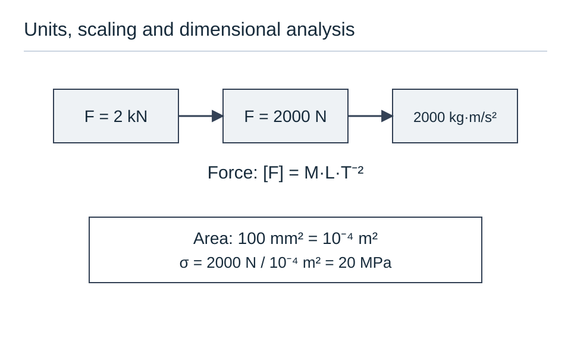

# M1-L1 – Units, scaling and dimensional analysis {#L1}

**Course area:** M1 – Engineering mathematics and modelling

**Level:** Bachelor

**Prerequisites:** Basic arithmetic and school algebra.

**Learning objective:** Convert units accurately and check equations for dimensional homogeneity.

## Introduction {#S1}

A designer receives a load in kilonewtons, a CAD area in square millimetres and a material property in megapascals. Inserting bare numbers can cause errors of several orders of magnitude. Dimensional checking is therefore part of the calculation rather than a cosmetic afterthought.

## Foundations, concepts and model {#S2}

A physical quantity consists of a numerical value and a unit. Dimensions describe the kind of quantity independently of its unit. Mass $M$, length $L$ and time $T$ suffice for many mechanical problems. From $F=ma$, $[F]=MLT^{-2}$; thus $1\,\mathrm{N}=1\,\mathrm{kg\,m/s^2}$. From $\sigma=F/A$, $[\sigma]=ML^{-1}T^{-2}$ and $1\,\mathrm{Pa}=1\,\mathrm{N/m^2}$.

For powers, the conversion factor applies to the entire unit: $1\,\mathrm{mm^2}=10^{-6}\,\mathrm{m^2}$, not $10^{-3}\,\mathrm{m^2}$. All terms in a sum must have the same dimension. The argument of an exponential or trigonometric function is dimensionless; an angle in radians is a ratio of lengths. Check orders of magnitude as well. If a geometrically similar body is scaled by a factor $\lambda$, areas grow with $\lambda^2$ and volumes with $\lambda^3$. At constant density, weight therefore increases faster than load-bearing cross-sectional area.

*Conversion of force and area with resulting normal stress.*

## Worked example {#S3}

An idealised tensile specimen is subjected to $2\,\mathrm{kN}$. Its cross-sectional area is $100\,\mathrm{mm^2}$. Convert: $F=2000\,\mathrm{N}$ and $A=100\cdot10^{-6}\,\mathrm{m^2}=10^{-4}\,\mathrm{m^2}$. Hence

$$
\sigma=\frac{2000}{10^{-4}}\,\mathrm{Pa}=20\,\mathrm{MPa}.
$$

Check in the N-mm system: $2000/100=20\,\mathrm{N/mm^2}=20\,\mathrm{MPa}$. The two routes agree.

## Self-assessment {#S4}

### Exercises

1. Convert 250 mm³ to m³.
2. A geometrically similar body doubles in every direction. How do mass and area change?

::: {.lc-solutions data-lc-section="S4"}
### Solutions

1. $250\cdot10^{-9}=2.5\cdot10^{-7}\,\mathrm{m^3}$.
2. At unchanged density, eight times the mass and four times the area.
:::

## Assumptions and limitations {#S5}

Dimensional homogeneity is necessary but does not prove an equation correct. Torque and energy, for example, have identical dimensions but distinct physical meanings. Scaling assumes geometric similarity and constant density.

## Summary and transition {#S6}

Carry units consistently and convert powers correctly; next account for directions and force components.

**Continue:** [M1-L2 – Vectors and forces](M1-L2.md)

## Sources {#S7}

- [OpenStax – University Physics Volume 1, 1.4 Dimensional Analysis](https://openstax.org/books/university-physics-volume-1/pages/1-4-dimensional-analysis) · §1.4: dimensional consistency · Last accessed: 2026-11-25

