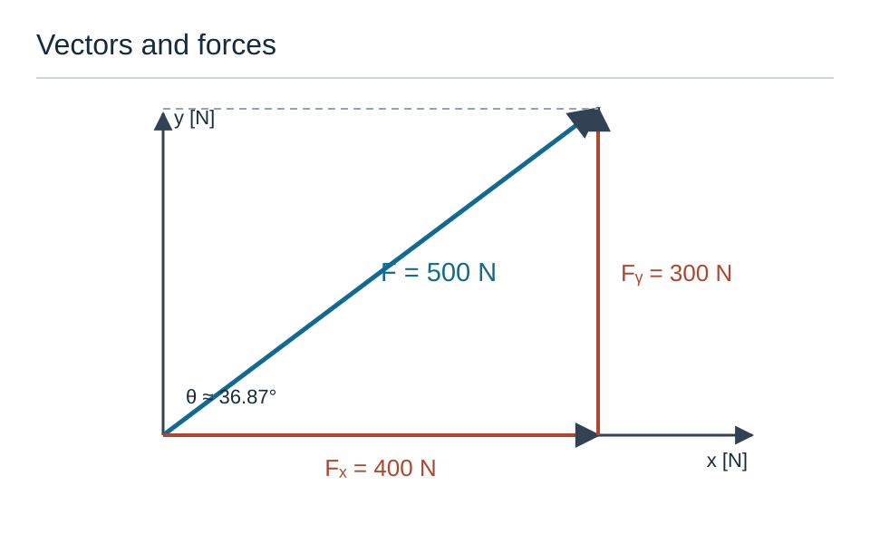

# M1-L2 – Vectors and forces {#L2}

**Course area:** M1 – Engineering mathematics and modelling

**Level:** Bachelor

**Prerequisites:** [M1-L1 – Units, scaling and dimensional analysis](M1-L1.md)

**Learning objective:** Resolve forces into components, determine resultants and apply dot and cross products.

## Introduction {#S1}

A cable pulls on a machine bracket. For bracket design, horizontal and vertical loads are often more important than the cable force magnitude alone.

## Foundations, concepts and model {#S2}

A Cartesian vector has components relative to orthogonal unit vectors: $\mathbf F=F_x\mathbf e_x+F_y\mathbf e_y+F_z\mathbf e_z$. In the plane, for an angle $\theta$ measured from the positive x-axis, $F_x=F\cos\theta$, $F_y=F\sin\theta$. In this plane, its magnitude is $F=\sqrt{F_x^2+F_y^2}$; components are added with their signs. A resultant describes the combined translational force effect; moments must also be balanced when application points differ.

The dot product $\mathbf F\cdot\mathbf s=F_xs_x+F_ys_y+F_zs_z$ gives the work of a constant force along the displacement. Perpendicular vectors have a zero dot product. The cross product $\mathbf M=\mathbf r\times\mathbf F$ gives the moment about a reference point, with direction given by the right-hand rule. In the xy-plane, $M_z=r_xF_y-r_yF_x$.

*A 500 N force resolved into orthogonal components of 400 N and 300 N.*

## Worked example {#S3}

A cable force has $F_x=400\,\mathrm N$, $F_y=300\,\mathrm N$. Its magnitude is $\sqrt{400^2+300^2}=500\,\mathrm N$ and its angle is $\arctan(300/400)\approx36.87^\circ$. With $\mathbf r=(0.2,0.1)\,\mathrm m$, $M_z=0.2\cdot300-0.1\cdot400=20\,\mathrm{N\,m}$ (counterclockwise). If instead the point of application moves by $\mathbf s=(0.05,0)\,\mathrm m$, the force does $W=400\cdot0.05=20\,\mathrm J$ of work, assuming constant direction and magnitude. The equal numerical values are coincidental; moment and work are not interchangeable.

## Self-assessment {#S4}

### Exercises

1. Add the forces (100, −20) N and (−30, 80) N.
2. What work is done by a force always perpendicular to the instantaneous direction of motion?

::: {.lc-solutions data-lc-section="S4"}
### Solutions

1. $(70,60)\,\mathrm N$; magnitude $\sqrt{8500}\,\mathrm N\approx92.2\,\mathrm N$.
2. Zero, because its local dot product with displacement is zero.
:::

## Assumptions and limitations {#S5}

The arctangent alone does not distinguish all quadrants. A two-argument angle function is appropriate for general components. For spatially distributed forces, the resultant alone does not describe rotational effects.

## Summary and transition {#S6}

Vector components and moments yield equations whose unknowns can be determined in linear systems.

**Continue:** [M1-L3 – Linear systems and matrices](M1-L3.md)

## Sources {#S7}

- [OpenStax – University Physics Volume 1, 2.4 Products of Vectors](https://openstax.org/books/university-physics-volume-1/pages/2-4-products-of-vectors) · §2.4: components, dot and cross products · Last accessed: 2026-11-25

