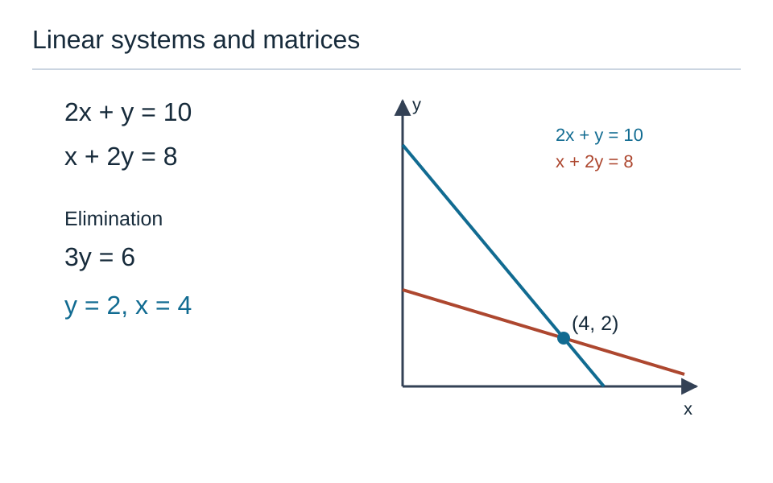

# M1-L3 – Linear systems and matrices {#L3}

**Course area:** M1 – Engineering mathematics and modelling

**Level:** Bachelor

**Prerequisites:** [M1-L2 – Vectors and forces](M1-L2.md)

**Learning objective:** Solve a linear system from a model and check its residual.

## Introduction {#S1}

When several support forces or displacements are unknown, equations must hold simultaneously. One measurement or one balance is often insufficient.

## Foundations, concepts and model {#S2}

A linear system $A\mathbf x=\mathbf b$ collects coefficients in a matrix, unknowns in one vector and known right-hand sides in another. Rows correspond to equations. Gaussian elimination combines equations so that unknowns disappear step by step. Permitted operations are swapping rows, multiplying a row by a nonzero factor and adding a multiple of another row.

For a square matrix of full rank, the solution is unique. With rank deficiency, inconsistent boundary conditions or infinitely many solutions may occur. A small determinant alone is not a reliable conditioning indicator without reference to scaling. Numerical calculations therefore use pivoting and appropriate scaling. The residual $\mathbf r=\mathbf b-A\hat{\mathbf x}$ checks whether the equations are satisfied; an ill-conditioned matrix can still produce a large solution error.

Linear structural mechanics uses the same form as $K\mathbf u=\mathbf f$. The stiffness matrix $K$ relates displacements to forces; missing supports can produce rigid-body modes and a singular matrix.

*Two linear equations and their common intersection.*

## Worked example {#S3}

Two normalised unknown quantities $x,y$ satisfy $2x+y=10$ and $x+2y=8$. Multiply the second equation by two and subtract the first: $3y=6$. Thus $y=2$, and the first equation gives $x=(10-2)/2=4$. Check: $2\cdot4+2=10$ and $4+2\cdot2=8$. The residual is $(0,0)$. Geometrically the two lines intersect at $(4,2)$.

## Self-assessment {#S4}

### Exercises

1. Solve x+y=7 and x−y=1.
2. Why does x+y=3 and 2x+2y=8 have no solution?

::: {.lc-solutions data-lc-section="S4"}
### Solutions

1. Addition gives 2x=8, so x=4 and y=3.
2. The first equation requires 2x+2y=6, contradicting the second.
:::

## Assumptions and limitations {#S5}

Linear systems apply only to linear or suitably linearised models. Frictional contact, large deformation and plastic material behaviour cannot generally be described by a constant matrix.

## Summary and transition {#S6}

Elimination and residuals are foundations of numerical mechanics; time-dependent models also require derivatives and integrals.

**Continue:** [M1-L4 – Differential and integral calculus](M1-L4.md)

## Sources {#S7}

- [MIT OCW – Linear Algebra, Elimination with Matrices](https://ocw.mit.edu/courses/18-06sc-linear-algebra-fall-2011/pages/ax-b-and-the-four-subspaces/elimination-with-matrices/) · Session Overview: elimination method; individual examples are original · Last accessed: 2026-11-25

