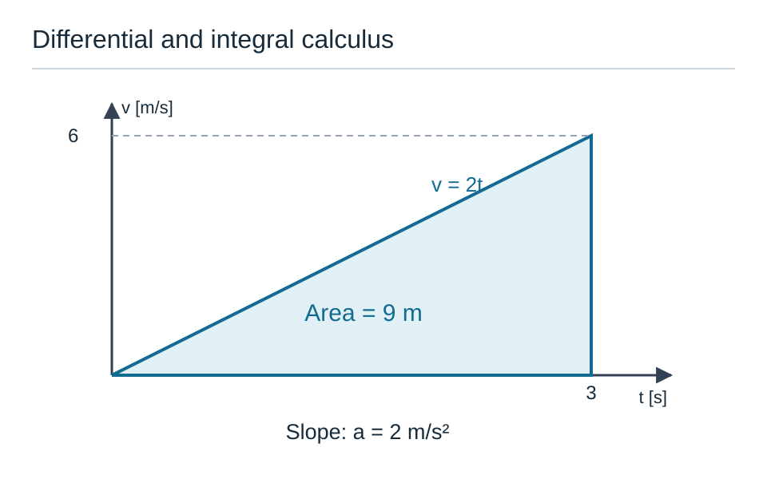

# M1-L4 – Differential and integral calculus {#L4}

**Course area:** M1 – Engineering mathematics and modelling

**Level:** Bachelor

**Prerequisites:** [M1-L3 – Linear systems and matrices](M1-L3.md)

**Learning objective:** Interpret derivatives as rates of change and integrals as accumulated quantities.

## Introduction {#S1}

A feed axis accelerates during start-up. Its final velocity does not describe the distance already travelled.

## Foundations, concepts and model {#S2}

The derivative $f'(t)=\lim_{h\to0}[f(t+h)-f(t)]/h$ describes a local rate of change. For position $x(t)$, $v=\mathrm dx/\mathrm dt$ and $a=\mathrm dv/\mathrm dt$. Their SI units are m/s and m/s². A stationary point satisfies $f'=0$; whether it is a local extremum can be tested, for example, by a sign change of the derivative or a suitable higher-derivative test. Endpoints and nondifferentiable points can also be extrema.

The definite integral $\int_a^b f(t)\,\mathrm dt$ accumulates contributions over an interval. The fundamental theorem relates it to an antiderivative $F$: $\int_a^b f(t)\,\mathrm dt=F(b)-F(a)$, provided its conditions hold. In mechanics, $x(t)-x(0)=\int_0^t v(\tau)\,\mathrm d\tau$. When direction changes, this displacement is not the path length, which is obtained by integrating $|v|$. For a position-dependent force, $W=\int F_x\,\mathrm dx$ gives work along the x-direction.

*Velocity-time diagram with linear velocity and triangular displacement area.*

## Worked example {#S3}

A hypothetical axis moves during $0\le t\le3\,\mathrm s$ with $v(t)=at$, where $a=2\,\mathrm{m/s^2}$. Its velocity after 3 s is 6 m/s. Acceleration is constant. The distance travelled is

$$
\Delta x=\int_0^{3\,\mathrm s}at\,\mathrm dt=\frac{a(3\,\mathrm s)^2}{2}=9\,\mathrm m.
$$

The geometric check using the triangular area $3\,\mathrm s\cdot6\,\mathrm{m/s}/2$ also gives 9 m.

## Self-assessment {#S4}

### Exercises

1. A constant force of 80 N acts parallel to a displacement of 0.25 m. Determine the work.
2. A body moves for one second at +2 m/s and one second at −2 m/s. Find displacement and path length.

::: {.lc-solutions data-lc-section="S4"}
### Solutions

1. W = 80 N · 0.25 m = 20 J.
2. Displacement 0 m, path length 4 m.
:::

## Assumptions and limitations {#S5}

The calculation with piecewise constant velocity idealises abrupt transitions; real machines have limited acceleration and jerk. Numerical derivatives from noisy measurements can fluctuate considerably.

## Summary and transition {#S6}

Derivatives and integrals link state variables; equations of motion thereby lead to differential equations.

**Continue:** [M1-L5 – Differential equations and numerical error](M1-L5.md)

## Sources {#S7}

- [OpenStax – Calculus Volume 1, 3.1 Defining the Derivative](https://openstax.org/books/calculus-volume-1/pages/3-1-defining-the-derivative) · §3.1: derivative as limit · Last accessed: 2026-11-25
- [OpenStax – Calculus Volume 1, 5.3 The Fundamental Theorem of Calculus](https://openstax.org/books/calculus-volume-1/pages/5-3-the-fundamental-theorem-of-calculus) · §5.3: derivative and definite integral · Last accessed: 2026-11-25

