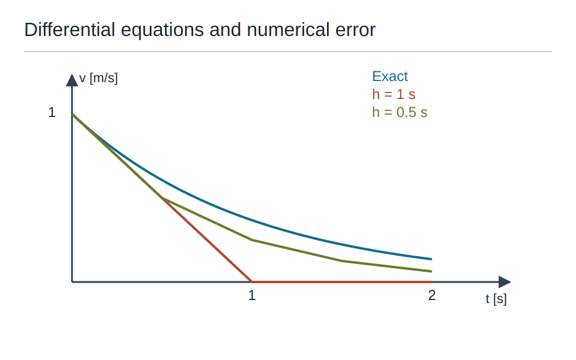

# M1-L5 – Differential equations and numerical error {#L5}

**Course area:** M1 – Engineering mathematics and modelling

**Level:** Bachelor

**Prerequisites:** [M1-L4 – Differential and integral calculus](M1-L4.md)

**Learning objective:** Discretise a simple initial-value problem and assess how error depends on step size.

## Introduction {#S1}

A simplified model of a viscously damped mass predicts how its velocity decays. Numerical simulation replaces a continuous time function with discrete time points.

## Foundations, concepts and model {#S2}

The equation of motion for a freely sliding mass subject to a linear drag force is $m\dot v=-cv$, where $c$ has units kg/s. With $k=c/m>0$, this becomes $\dot v=-kv$. Separation of variables and the initial condition $v(0)=v_0$ give $v(t)=v_0\exp(-kt)$.

For a general equation $\dot y=f(t,y)$, the explicit Euler method can be used. The local tangent approximation gives

$$
y_{n+1}=y_n+h f(t_n,y_n),\quad t_{n+1}=t_n+h.
$$

For the damped mass, this becomes $v_{n+1}=(1-kh)v_n$. Under usual smoothness assumptions, the local one-step error (starting from the exact value at the beginning of the step) is of order $h^2$, and global error over a fixed finite interval is of order $h$ under the usual stability and Lipschitz conditions. For the linear test equation with $k>0$, the numerical value decays if $|1-kh|<1$. For $1<kh<2$, its magnitude still decays, but the sign alternates, which is unphysical in this example.

*Exact exponential decay and explicit Euler approximations for two step sizes.*

## Worked example {#S3}

Set $k=1\,\mathrm{s^{-1}}$ and $v_0=1\,\mathrm{m/s}$. With $h=1\,\mathrm s$, Euler gives zero after just one step. With $h=0.5\,\mathrm s$, the successive values are 0.5, 0.25, 0.125 and 0.0625 m/s. After 2 s, the exact value is $\exp(-2)\,\mathrm{m/s}\approx0.13534\,\mathrm{m/s}$. The absolute error of the finer calculation is about 0.07284 m/s. A stable computation can therefore still have insufficient accuracy.

## Self-assessment {#S4}

### Exercises

1. For k=1 s⁻¹ and h=0.25 s, find the first Euler step starting from 1 m/s.
2. What happens for k=1 s⁻¹ and h=3 s?

::: {.lc-solutions data-lc-section="S4"}
### Solutions

1. v₁=(1−0.25)·1=0.75 m/s.
2. The amplification factor is −2; the sequence alternates sign and grows in magnitude.
:::

## Assumptions and limitations {#S5}

The stability region was derived for this particular linear test equation. Nonlinear or stiff systems require suitable integrators and a separate convergence study. The TUM and KIT sources support the curricular methods area. Section 2.15.1 of the linked NTNU teaching material supports the stability analysis of the explicit Euler method.

## Summary and transition {#S6}

Distinguish discretisation and modelling errors; uncertainty must also be quantified separately for real measurements.

**Continue:** [M1-L6 – Probability and statistics](M1-L6.md)

## Sources {#S7}

- [TUM – Maschinenwesen B.Sc.](https://www.ed.tum.de/ed/studium/studienangebot/maschinenwesen-b-sc/) · Studieninhalte und Studienstruktur; Grundlagen 1–4, Wahlbereich 5–6; Mechanik, IT, Werkstoffe, CAD, Thermofluide, Regelung · Last accessed: 2026-11-25
- [KIT – Maschinenbau M.Sc.](https://www.sle.kit.edu/vorstudium/master-maschinenbau.php) · Studienaufbau; mathematische Methoden, Daten, Simulation, Auslegung, zwei Schwerpunkte, Labor, Arbeit; SPO 2025 verlinkt · Last accessed: 2026-11-25
- [NTNU – Numerical Methods for Engineers, 2.15 Absolute stability of numerical methods for ODE IVPs](https://leifh.folk.ntnu.no/teaching/tkt4140/._main025.html) · §2.15.1, equations (2.132)–(2.148): Euler recurrence, stability and oscillation · Last accessed: 2026-11-25 · Content verified: 2026-11-25
