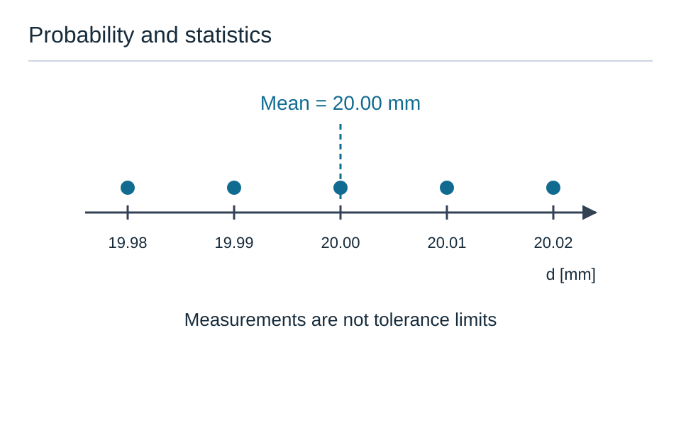

# M1-L6 – Probability and statistics {#L6}

**Course area:** M1 – Engineering mathematics and modelling

**Level:** Bachelor

**Prerequisites:** [M1-L5 – Differential equations and numerical error](M1-L5.md)

**Learning objective:** Explain the mean, sample standard deviation and limits of statistical conclusions about manufacturing data.

## Introduction {#S1}

Five manufactured shafts have slightly different diameters. A mean close to the target does not yet reveal how much individual parts deviate.

## Foundations, concepts and model {#S2}

A sample consists of observed values $x_1,\ldots,x_n$. The arithmetic mean is $\bar x=\sum_i x_i/n$. Sample variance $s^2=\sum_i(x_i-\bar x)^2/(n-1)$ for $n>1$ measures spread. Its square root $s$ has the same unit as the measurements. For independent, identically distributed observations with finite variance, $s^2$ is an unbiased estimator of population variance; the standard deviation itself is not generally unbiased.

The probability of an event lies between zero and one. For independent events, $P(A\cap B)=P(A)P(B)$. Independence must not be assumed without checking for consecutive manufactured parts: tool wear can produce a time trend. Empirical frequency is an estimate, not a guaranteed future rejection rate. Under independent sampling, the standard uncertainty of the mean due to spread can be estimated by $s/\sqrt n$; systematic calibration errors are not included.

*Five hypothetical diameter measurements around the mean of 20 mm.*

## Worked example {#S3}

Five hypothetical diameters are 19.98, 19.99, 20.00, 20.01 and 20.02 mm. Their mean is exactly 20.00 mm. The sum of squared deviations is $(0.0004+0.0001+0+0.0001+0.0004)\,\mathrm{mm^2}=0.001\,\mathrm{mm^2}$. Hence

$$
s=\sqrt{0.001/4}\,\mathrm{mm}\approx0.01581\,\mathrm{mm}.
$$

The estimated standard uncertainty of the mean from spread is $0.01581/\sqrt5\approx0.00707\,\mathrm{mm}$ for independent observations. Without specified acceptance limits, this cannot establish conformity.

## Self-assessment {#S4}

### Exercises

1. Three measurements are 9, 10 and 11 mm. Calculate mean and sample standard deviation.
2. Two independent parts each have a hypothetical defect probability of 0.02. What is the probability that both are defective?

::: {.lc-solutions data-lc-section="S4"}
### Solutions

1. 10 mm; s=√((1+0+1)/2) mm=1 mm.
2. 0.02·0.02=0.0004=0.04%.
:::

## Assumptions and limitations {#S5}

A small sample establishes neither normality nor process stability. Measurement uncertainty, serial correlation and actual specifications must be checked separately.

## Summary and transition {#S6}

Statistical conclusions complement mechanical models. The next module balances forces and moments on isolated bodies.

**Continue:** [M2-L1 – Free-body diagrams and equilibrium](M2-L1.md)

## Sources {#S7}

- [OpenStax – Introductory Statistics 2e, 2.5 Measures of the Center of the Data](https://openstax.org/books/introductory-statistics-2e/pages/2-5-measures-of-the-center-of-the-data) · §2.5: sample mean and median · Last accessed: 2026-11-25
- [OpenStax – Introductory Statistics 2e, 2.7 Measures of the Spread of the Data](https://openstax.org/books/introductory-statistics-2e/pages/2-7-measures-of-the-spread-of-the-data) · §2.7: standard deviation · Last accessed: 2026-11-25

