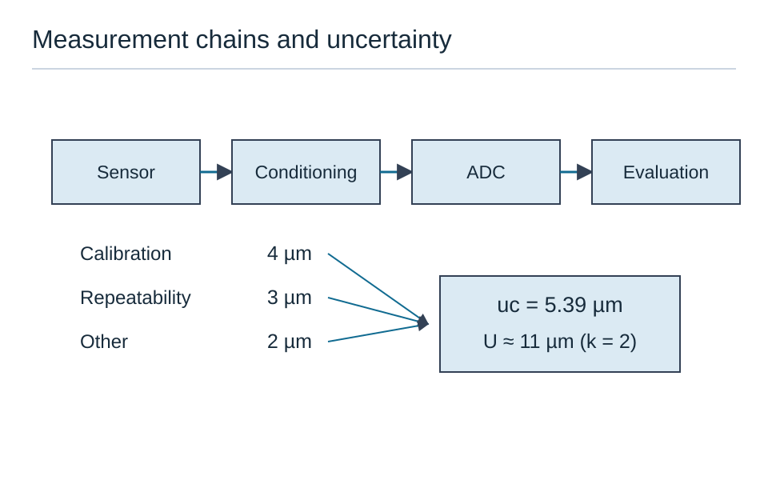

# M10-L1 – Measurement chains and uncertainty {#L1}

**Course area:** M10 – Measurement and mechatronics

**Level:** Bachelor

**Prerequisites:** [M1-L1 – Units, scaling and dimensional analysis](M1-L1.md)

**Learning objective:** Define measurands and combine independent standard uncertainties.

## Introduction {#S1}

A measurement value without unit, method and uncertainty cannot support a reliable statement about a part requirement.

## Foundations, concepts and model {#S2}

The measurement chain begins with a definition of the measurand, such as diameter at a specified location and temperature. A sensor converts a physical quantity to a signal. Amplification, filtering, analogue-to-digital conversion and evaluation can introduce deviations. Calibration establishes the relationship between indication and reference under specified conditions. Resolution is not accuracy; even repeatable results can have systematic errors.

Type A evaluations use statistical observations; type B evaluations use other information, for example calibration certificates. For a measurement model $y=f(x_1,\ldots,x_n)$ and uncorrelated inputs, linear uncertainty propagation yields $u_c^2=\sum_i(c_i u_i)^2$ with $c_i=\partial f/\partial x_i$. Correlation requires covariance terms. Expanded uncertainty $U=k u_c$ requires a justified coverage factor. A result near a specification limit calls for an agreed decision rule.

*Measurement chain with sensor, signal conditioning and digital evaluation plus uncertainty budget.*

## Worked example {#S3}

A corrected diameter is 20.012 mm. Three uncorrelated standard uncertainties with sensitivity coefficient 1 are 0.004, 0.003 and 0.002 mm. u_c = √(0.004² + 0.003² + 0.002²) = 0.00539 mm. With illustrative k = 2, U = 0.01077 mm, rounded to 0.011 mm. Result: (20.012 ± 0.011) mm, k = 2. With an upper specification limit of 20.020 mm the interval overlaps that limit.

## Self-assessment {#S4}

### Exercises

1. What is the combination of independent standard uncertainties of 3 and 4 µm?
2. Does k = 2 always give exactly 95% coverage?

::: {.lc-solutions data-lc-section="S4"}
### Solutions

1. 5 µm.
2. No; distribution, effective degrees of freedom and evaluation method determine coverage.
:::

## Assumptions and limitations {#S5}

Assumes linearisation and uncorrelated inputs. The example defines no acceptance or rejection rule for actual parts.

## Summary and transition {#S6}

Measurement uncertainty describes limited knowledge of the measurand; a measurement decision additionally requires a rule.

**Continue:** [M10-L2 – Sensors and actuators](M10-L2.md)

## Sources {#S7}

- [NIST/SEMATECH e-Handbook – Approach to uncertainty](https://www.itl.nist.gov/div898/handbook/mpc/section5/mpc52.htm) · §2.5.2: type A and B, quadrature, expanded uncertainty · Last accessed: 2026-11-25

