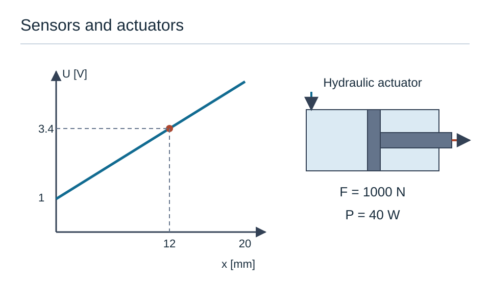

# M10-L2 – Sensors and actuators {#L2}

**Course area:** M10 – Measurement and mechatronics

**Level:** Bachelor

**Prerequisites:** [M10-L1 – Measurement chains and uncertainty](M10-L1.md)

**Learning objective:** Compare sensor principles, evaluate characteristics and estimate actuator quantities.

## Introduction {#S1}

Mechatronics couples mechanical components, electrical signals and information processing. Sensors observe states; actuators alter them.

## Foundations, concepts and model {#S2}

A strain gauge changes electrical resistance with strain. Inductive sensors can detect metallic targets without contact; optical encoders supply position information. A linear sensor characteristic follows $y=Sx+b$, where S is sensitivity and b offset. Hysteresis, nonlinearity, temperature drift, range and dynamic bandwidth limit the model. Selection depends on interference, required resolution and response time, among other factors.

Actuators convert supplied energy into motion or force. A hydraulic cylinder uses pressure differences; for an ideal cylinder with equal effective areas A on both sides (or zero gauge pressure on the return side), $F=\Delta p A$, and neglecting leakage and compressibility $Q=Av$. Electric motors, pneumatics and piezoelectric drives have distinct force, travel and speed profiles. Power follows paired energy quantities, for example $P=Fv=\Delta p Q$ in a lossless hydraulic model.

*Linear sensor characteristic and actuator as an energy converter in a mechatronic chain.*

## Worked example {#S3}

A hypothetical displacement sensor produces 1 V at 0 mm and 5 V at 20 mm. S = 4/20 = 0.2 V/mm, b = 1 V; 3.4 V gives x = 12 mm. An ideal model actuator has A = 5 cm² = 0.0005 m², Δp = 2 MPa and v = 0.04 m/s. F = 1000 N, Q = 0.00002 m³/s = 1.2 L/min and P = 40 W.

## Self-assessment {#S4}

### Exercises

1. What displacement corresponds to 2 V?
2. How does ideal force change if area doubles at constant pressure difference?

::: {.lc-solutions data-lc-section="S4"}
### Solutions

1. 5 mm.
2. It doubles.
:::

## Assumptions and limitations {#S5}

Linear calibration within range; actuator model without friction, leakage, inertia or pressure surges. Not real operating parameters.

## Summary and transition {#S6}

Sensors deliver information; actuators transfer energy. Both require models of static and dynamic behaviour.

**Continue:** [M10-L3 – Electrical drives](M10-L3.md)

## Sources {#S7}

- [MIT OCW – Design and Manufacturing I: Lecture Notes](https://ocw.mit.edu/courses/2-007-design-and-manufacturing-i-spring-2009/pages/lecture-notes/) · Lecture index 3, 14, 16: actuators, microcontrollers, sensors; individual PDFs not reviewed · Last accessed: 2026-11-25

