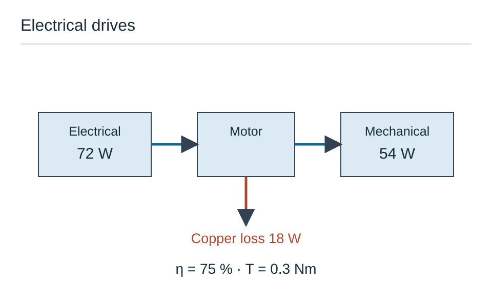

# M10-L3 – Electrical drives {#L3}

**Course area:** M10 – Measurement and mechatronics

**Level:** Bachelor

**Prerequisites:** [M10-L2 – Sensors and actuators](M10-L2.md)

**Learning objective:** Calculate torque, back EMF, speed and losses of a simple motor model.

## Introduction {#S1}

Electric drive selection combines mechanical load profile, power supply, heat removal and control.

## Foundations, concepts and model {#S2}

For a simplified permanent-magnet DC motor, $V=Ri+L\,di/dt+k_e\omega$ and $T_e=k_t i$. The term $k_e\omega$ is back EMF, increasing with rotational speed. Mechanical motion follows $J\dot\omega=T_e-T_L-b\omega$. In coherent SI units k_t and k_e are numerically equal for the ideal electromechanical converter. At constant current, the idealised electrical model gives $Vi=Ri^2+T_e\omega$. The second term is electromagnetically converted power; at mechanical steady state, subtract mechanical losses to obtain shaft power. Real motors have additional losses, thermal limits and limited torque-speed envelopes.

AC drives include induction machines and permanent-magnet synchronous machines. A converter influences voltages, currents and frequencies; control must respect the load profile and drive-system limits. Gearing can adapt speed and torque but adds losses and backlash. Rated power alone describes neither starting torque nor permissible short-term loading.

*DC motor model with electrical and mechanical power balances.*

## Worked example {#S3}

A steady-state model motor has V = 24 V, R = 2 Ω, k_e = 0.1 V·s/rad, k_t = 0.1 Nm/A and i = 3 A. Back EMF = 24 − 6 = 18 V, ω = 180 rad/s ≈ 1719 rpm, T = 0.3 Nm. Input power 72 W, copper loss 18 W, mechanical power 54 W. Model efficiency 75%.

## Self-assessment {#S4}

### Exercises

1. What happens to torque at half current in the linear model?
2. What is modelled copper loss at 2 A?

::: {.lc-solutions data-lc-section="S4"}
### Solutions

1. It halves.
2. 8 W.
:::

## Assumptions and limitations {#S5}

No magnetic saturation, mechanical or iron losses; constant winding temperature in the example. Real electrical equipment requires suitable protective design.

## Summary and transition {#S6}

Back EMF and torque constant couple electrical circuit and mechanical motion.

**Continue:** [M10-L4 – Dynamic systems and feedback loops](M10-L4.md)

## Sources {#S7}

- [MIT OCW – Design and Manufacturing I: Lecture Notes](https://ocw.mit.edu/courses/2-007-design-and-manufacturing-i-spring-2009/pages/lecture-notes/) · Lecture index 3, 14, 16: actuators, microcontrollers, sensors; individual PDFs not reviewed · Last accessed: 2026-11-25
- [MIT OCW – Systems, Modeling, and Control II, Lecture 05](https://ocw.mit.edu/courses/2-004-systems-modeling-and-control-ii-fall-2007/92b7076d416d5ae7f9a26c100b52b724_lecture05.pdf) · Slides 6–10: torque, back EMF and coupled motor equations; background for drive modelling · Last accessed: 2026-11-25 · Content verified: 2026-11-25
- [OpenStax – University Physics 1: Work and Power for Rotational Motion](https://openstax.org/books/university-physics-volume-1/pages/10-8-work-and-power-for-rotational-motion) · §10.8 torque, work and power · Last accessed: 2026-11-25

