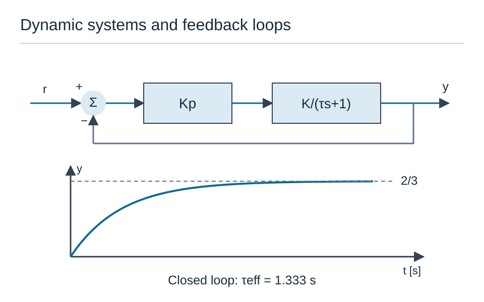

# M10-L4 – Dynamic systems and feedback loops {#L4}

**Course area:** M10 – Measurement and mechatronics

**Level:** Bachelor

**Prerequisites:** [M10-L3 – Electrical drives](M10-L3.md)

**Learning objective:** Distinguish open-loop control from feedback and analyse a simple dynamic model.

## Introduction {#S1}

A drive should reach a setpoint despite changing load and environment. The output is often measured and fed back for this purpose.

## Foundations, concepts and model {#S2}

Open-loop control acts without feedback of the output under consideration; feedback forms the error $e=r-y$ between reference r and measured output y. A controller produces manipulated input u. A first-order model $\tau\dot y+y=Ku$ with positive time constant τ and gain K can approximate thermal or mechanical processes. For a step input u₀ and y(0)=0, $y(t)=Ku_0(1-e^{-t/\tau})$.

With proportional feedback $u=K_p(r-y)$, the result is $\tau\dot y+(1+KK_p)y=KK_pr$. For $1+KK_p>0$ this ideal model is stable; effective time constant is $\tau/(1+KK_p)$ and steady-state gain is $KK_p/(1+KK_p)$. A PI controller adds an integral of error, which can eliminate steady-state error for an attainable constant reference if the closed loop is stable, integral gain is effective, and actuation is not persistently saturated. Saturation, delays, measurement noise and additional dynamics may cause overshoot or instability.

*Closed feedback loop and step response of a first-order system.*

## Worked example {#S3}

A normalised system has K = 2 and τ = 4 s. For an open-loop unit step, y(4 s) = 2·(1−e⁻¹) ≈ 1.264. With K_p = 1, negative unity feedback and r = 1, τ_eff = 4/3 ≈ 1.333 s and y∞ = 2/3. Steady-state error is 1/3.

## Self-assessment {#S4}

### Exercises

1. What fraction of its final value does a first-order system reach after one time constant?
2. Does a larger proportional gain always guarantee stability?

::: {.lc-solutions data-lc-section="S4"}
### Solutions

1. About 63.2%.
2. No, additional real poles, delays and nonlinearities can limit stability.
:::

## Assumptions and limitations {#S5}

Only the stated linear single-pole model, ideal feedback and unlimited actuation. No controller design for real machinery without model and safety verification.

## Summary and transition {#S6}

Feedback changes dynamics and steady-state behaviour. Stability is a property of the entire closed loop.

**Continue:** [M10-L5 – Digital control and condition monitoring](M10-L5.md)

## Sources {#S7}

- [MIT OCW – Design and Manufacturing I: Lecture Notes](https://ocw.mit.edu/courses/2-007-design-and-manufacturing-i-spring-2009/pages/lecture-notes/) · Lecture index 3, 14, 16: actuators, microcontrollers, sensors; individual PDFs not reviewed · Last accessed: 2026-11-25
- [MIT OCW – Systems, Modeling, and Control II, Lecture 05](https://ocw.mit.edu/courses/2-004-systems-modeling-and-control-ii-fall-2007/92b7076d416d5ae7f9a26c100b52b724_lecture05.pdf) · Slides 6–10: torque, back EMF and coupled motor equations; background for drive modelling · Last accessed: 2026-11-25 · Content verified: 2026-11-25

