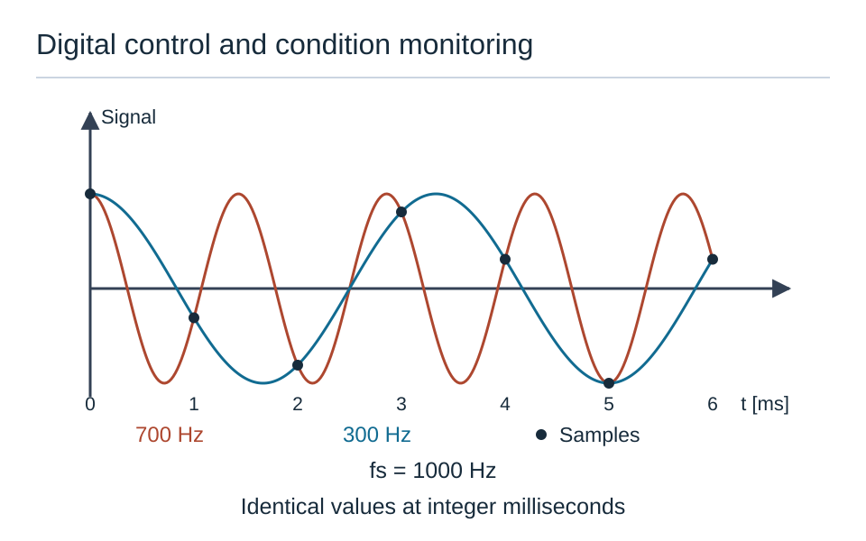

# M10-L5 – Digital control and condition monitoring {#L5}

**Course area:** M10 – Measurement and mechatronics

**Level:** Bachelor

**Prerequisites:** [M10-L4 – Dynamic systems and feedback loops](M10-L4.md)

**Learning objective:** Distinguish sampling, sequence control and condition monitoring and determine alias frequencies.

## Introduction {#S1}

Digital controllers execute logical and discrete-time tasks. Condition monitoring extracts additional information from operating data but does not replace safety-related protective functions.

## Foundations, concepts and model {#S2}

A programmable logic controller (PLC) processes inputs, executes logic and updates outputs. A state machine describes permissible transitions between defined operating states with events and conditions. Scan time, communications and actuator delay affect response time. Safety functions require separately verified architecture; ordinary operating logic is not proof of their effectiveness.

A discrete-time measurement signal has sampling period T_s and rate $f_s=1/T_s$. For band-limited signals, $f_s>2f_{max}$ is required for ideal reconstruction. An analogue anti-aliasing filter before conversion suppresses higher frequencies. Condition monitoring may use root mean square $x_{RMS}=\sqrt{\sum_{i=1}^N x_i^2/N}$, spectra or temperature trends as features. Load, speed, sensor mounting and ageing influence signals. Changes are indications, not unique fault diagnoses.

*Discrete sampling of a signal and identical sample points for two frequencies due to aliasing.*

## Worked example {#S3}

At f_s = 1000 Hz, 700 Hz and 300 Hz (1000−700) cosine signals with equal amplitudes, zero initial phase and common sampling instants give identical samples. A pre-sampling filter must adequately attenuate unwanted frequencies. Four acceleration samples 2, −2, 4, −4 m/s² give RMS = √(40/4) = 3.162 m/s². Four values alone cannot establish a reliable machine diagnosis.

## Self-assessment {#S4}

### Exercises

1. What sampling period corresponds to 2 kHz?
2. Why is a higher sampling rate without filtering not always sufficient?

::: {.lc-solutions data-lc-section="S4"}
### Solutions

1. 0.5 ms.
2. Higher signal or noise components may still fold back into the band of interest.
:::

## Assumptions and limitations {#S5}

Ideal uniform sampling and hypothetical signal values. Diagnosis requires validated reference data, operating conditions and expert review.

## Summary and transition {#S6}

Digital control processes states and signals; measurement quality and context determine monitoring validity.

**Continue:** [M11-L1 – Numerical modelling and verification](M11-L1.md)

## Sources {#S7}

- [MIT OCW – Design and Manufacturing I: Lecture Notes](https://ocw.mit.edu/courses/2-007-design-and-manufacturing-i-spring-2009/pages/lecture-notes/) · Lecture index 3, 14, 16: actuators, microcontrollers, sensors; individual PDFs not reviewed · Last accessed: 2026-11-25
- [MIT OCW – Signals and Systems, Lecture 16: Sampling](https://ocw.mit.edu/courses/res-6-007-signals-and-systems-spring-2011/8708ec068ebdea2c4ee2f38fad39fb83_MITRES_6_007S11_lec16.pdf) · pp. 16-1 to 16-2: sampling theorem and aliasing · Last accessed: 2026-11-25 · Content verified: 2026-11-25
- [NIST – Handbook of Frequency Stability Analysis: Section Ten](https://tf.nist.gov/phase/Properties/ten.htm) · Section 10.3: aliasing and anti-aliasing filters · Last accessed: 2026-11-25
- [NIST – A Generalized Method for Featurization of Manufacturing Signals, with Application to Tool Condition Monitoring](https://www.nist.gov/publications/generalized-method-featurization-manufacturing-signals-application-tool-condition) · 2017 publication abstract: signal acquisition and tool condition prediction · Last accessed: 2026-11-25

