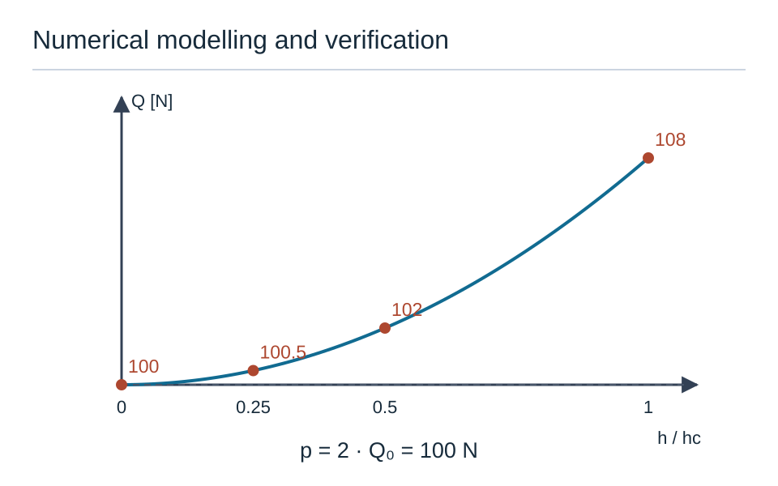

# M11-L1 – Numerical modelling and verification {#L1}

**Course area:** M11 – Simulation and numerical methods

**Level:** Master

**Prerequisites:** [M2-L4 – Stress, strain and tension](M2-L4.md), [M5-L2 – First law and energy balances](M5-L2.md)

**Learning objective:** Estimate discretisation error and distinguish verification from validation.

## Introduction {#S1}

A numerical result initially describes a model, not the actual component.

## Foundations, concepts and model {#S2}

Verification asks whether the model equations are solved correctly; validation asks whether the equations represent observed reality adequately for the intended use. Code verification employs analytical or manufactured solutions; solution verification examines mesh and time-step errors, for example. Model parameters, boundary conditions, rounding and iterative termination are separate error sources. A small residual alone does not establish spatial convergence.

Let $Q(h)=Q_0+Ch^p$ be an asymptotic error expansion for a scalar quantity of interest. With three uniformly refined grids $h,h/r,h/r^2$ with $r>1$ and nonzero differences of the same sign whose magnitude decreases under refinement, $p=\ln[(Q_c-Q_m)/(Q_m-Q_f)]/\ln r$. Richardson extrapolation gives $Q_0\approx Q_f+(Q_f-Q_m)/(r^p-1)$. Non-monotonic data, changing mesh quality or multiple dominant error terms can invalidate the estimate.

*Mesh refinement with three results and extrapolated limit.*

## Worked example {#S3}

With r = 2, Qc = 108 N, Qm = 102 N and Qf = 100.5 N. p = ln(6/1.5)/ln(2) = 2. Q₀ ≈ 100.5 − 1.5/3 = 100 N. The estimated relative fine-grid error with respect to Q₀ is 0.5%.

## Self-assessment {#S4}

### Exercises

1. How large is the leading error after halving h when p = 2?
2. Does grid convergence establish the validity of a turbulence model?

::: {.lc-solutions data-lc-section="S4"}
### Solutions

1. One quarter of the previous error.
2. No; validation against suitable reference data is needed.
:::

## Assumptions and limitations {#S5}

Only one leading error term in the asymptotic region; not a standards-compliant uncertainty certificate.

## Summary and transition {#S6}

Document numerical accuracy and physical model adequacy separately.

**Continue:** [M11-L2 – Finite element method](M11-L2.md)

## Sources {#S7}

- [NASA Glenn / NPARC – Conducting and Reporting a CFD Analysis](https://www.grc.nasa.gov/www/wind/TFAWS2007/Conducting-Reporting.pdf) · Slides Verification Assessment, Grid Convergence Study and Order of Convergence (20–24): verification, convergence order and Richardson extrapolation · Last accessed: 2026-11-25 · Content verified: 2026-11-25

