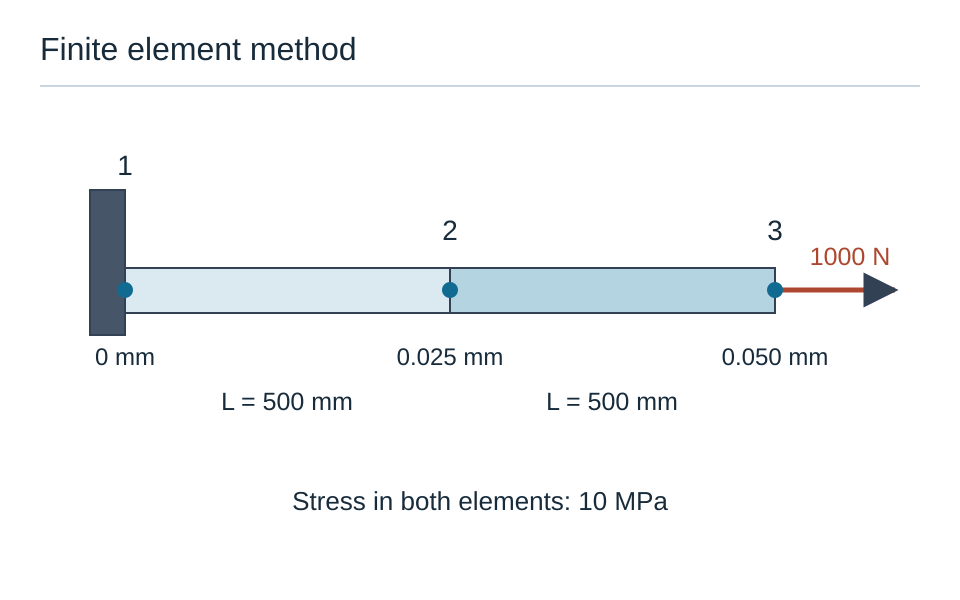

# M11-L2 – Finite element method {#L2}

**Course area:** M11 – Simulation and numerical methods

**Level:** Master

**Prerequisites:** [M11-L1 – Numerical modelling and verification](M11-L1.md)

**Learning objective:** Assemble a global stiffness matrix from two elements and apply boundary conditions.

## Introduction {#S1}

FEM replaces a continuous displacement field with finitely many degrees of freedom.

## Foundations, concepts and model {#S2}

In the displacement formulation, $u(x)=N_1u_1+N_2u_2$ is interpolated within an element. For a linear bar, $N_1=1-x/L$, $N_2=x/L$, $\epsilon=du/dx$ and $\sigma=E\epsilon$. Internal virtual work gives the element matrix $K_e=\int_0^L B^TEAB\,dx$, with $B=[-1/L,1/L]$. For constant cross-sectional area A and Young's modulus E, $K_e=(EA/L)\begin{bmatrix}1&-1\\-1&1\end{bmatrix}$.

Assembly adds element contributions at shared global degrees of freedom. Prescribed displacements are essential boundary conditions; forces enter the right-hand side. After their treatment, $Ku=f$ can be solved. Reactions follow from the original equations and stresses from element displacements. A free rigid-body mode makes the static matrix singular.

*Two axial bar elements with three nodes, a fixed support and end force.*

## Worked example {#S3}

Two equal elements with L = 500 mm, E = 200,000 N/mm² and A = 100 mm² each give k = 40,000 N/mm. The global matrix is $k\begin{bmatrix}1&-1&0\\-1&2&-1\\0&-1&1\end{bmatrix}$. With u₁ = 0 and F₃ = 1000 N, 2u₂ − u₃ = 0 and −u₂ + u₃ = 0.025 mm. Thus u₂ = 0.025 mm and u₃ = 0.050 mm. Both stresses are 10 MPa; the support reaction is −1000 N.

## Self-assessment {#S4}

### Exercises

1. What is u₃ if both bar areas double?
2. Why is a finer mesh insufficient if boundary conditions are wrong?

::: {.lc-solutions data-lc-section="S4"}
### Solutions

1. 0.025 mm.
2. It approaches the solution of the wrong problem.
:::

## Assumptions and limitations {#S5}

Small deformation, one-dimensional linear elasticity, constant cross sections, no stability or contact problems.

## Summary and transition {#S6}

FEM connects local element matrices with global equilibrium and verifiable boundary conditions.

**Continue:** [M11-L3 – Computational fluid dynamics](M11-L3.md)

## Sources {#S7}

- [MIT OCW – Mechanical Behavior of Plastics: finite element analysis](https://ocw.mit.edu/courses/3-91-mechanical-behavior-of-plastics-spring-2007/resources/18_fea/) · Resource description: element matrices and assembly; PDF not inspected · Last accessed: 2026-11-25

