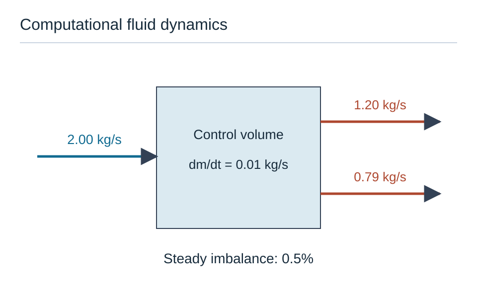

# M11-L3 – Computational fluid dynamics {#L3}

**Course area:** M11 – Simulation and numerical methods

**Level:** Master

**Prerequisites:** [M11-L2 – Finite element method](M11-L2.md)

**Learning objective:** Evaluate a discrete mass balance and classify CFD error sources.

## Introduction {#S1}

Flow simulation produces spatial fields from which pressure losses, forces or heat transfer are calculated.

## Foundations, concepts and model {#S2}

The finite volume method integrates a conservation equation over each cell. For mass, $d(\rho V)/dt+\sum_f \rho_f(\mathbf v_f\cdot\mathbf n_f)A_f=0$ on a stationary grid. Shared fluxes of adjacent cells must cancel with opposite signs. Momentum and energy balances additionally require pressure, stress and heat fluxes. Convection discretisation can introduce numerical diffusion; small cells often increase computational cost.

An inlet might prescribe velocity and temperature and an outlet pressure; the choice must suit the equations. At solid impermeable walls there is no normal flux, and a viscous no-slip condition also imposes wall velocity. Turbulence models close averaged equations with modelled additional terms. Check residuals, global conservation, quantities of interest and mesh or time-step independence separately.

*Control volume with mass flows at inlet and outlet.*

## Worked example {#S3}

A steady control volume has an inflow of 2.00 kg/s and outflows of 1.20 kg/s and 0.79 kg/s. Net outflow is −0.01 kg/s; the magnitude of the imbalance relative to inflow is 0.5%. For an exact steady balance the second outflow must be 0.80 kg/s.

## Self-assessment {#S4}

### Exercises

1. What mass change follows with unchanged fluxes in the transient case?
2. Does perfect mass conservation establish correct wall friction?

::: {.lc-solutions data-lc-section="S4"}
### Solutions

1. Mass increases at 0.01 kg/s.
2. No, momentum balance, wall model and validation must be checked separately.
:::

## Assumptions and limitations {#S5}

Fixed control volumes and no mass sources; numerical teaching example, not a universal acceptance threshold.

## Summary and transition {#S6}

Conservation and model assessment matter more than a visually compelling flow plot.

**Continue:** [M11-L4 – Multibody simulation](M11-L4.md)

## Sources {#S7}

- [NASA Glenn / NPARC – Conducting and Reporting a CFD Analysis](https://www.grc.nasa.gov/www/wind/TFAWS2007/Conducting-Reporting.pdf) · Slides Verification Assessment, Grid Convergence Study and Order of Convergence (20–24): verification, convergence order and Richardson extrapolation · Last accessed: 2026-11-25 · Content verified: 2026-11-25

