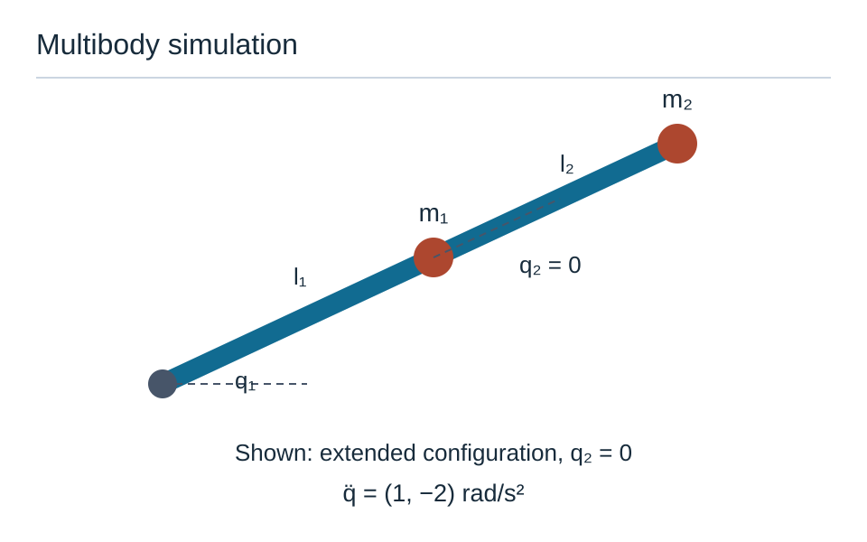

# M11-L4 – Multibody simulation {#L4}

**Course area:** M11 – Simulation and numerical methods

**Level:** Master

**Prerequisites:** [M11-L3 – Computational fluid dynamics](M11-L3.md)

**Learning objective:** Explain generalised coordinates and coupled inertial forces using a mechanism.

## Introduction {#S1}

In a jointed system the motion of one link affects forces in other links.

## Foundations, concepts and model {#S2}

For independent generalised coordinates $q$, kinetic energy can be written $T=\frac12\dot q^TM(q)\dot q$. With kinetic energy T and conservative potential energy V, $L=T-V$ is the Lagrangian. The Euler–Lagrange equation $d(\partial L/\partial\dot q_i)/dt-\partial L/\partial q_i=Q_i$ with Q_i denoting generalised forces not already represented in V, leads to $M(q)\ddot q+C(q,\dot q)\dot q+g(q)=\tau$ for an open jointed system. Off-diagonal entries of M describe dynamic coupling. Closed loops can require additional constraints $\Phi(q)=0$ and multipliers.

For a planar two-joint arm with massless links and point masses m₁ at the first and m₂ at the second endpoint, using a relative second angle, $M_{11}=(m_1+m_2)l_1^2+m_2l_2^2+2m_2l_1l_2\cos q_2$, $M_{12}=M_{21}=m_2l_2^2+m_2l_1l_2\cos q_2$ and $M_{22}=m_2l_2^2$. Numerical integration needs consistent initial values; contact and friction require additional models.

*Planar two-link mechanism with joint angles q1 and q2.*

## Worked example {#S3}

m₁ = m₂ = 1 kg, l₁ = l₂ = 1 m, q₂ = 0. In the horizontal motion plane at rest, $M=\begin{bmatrix}5&2\\2&1\end{bmatrix}$ kg m². For τ = (1, 0) Nm, $M\ddot q=\tau$ gives accelerations (1, −2) rad/s². Relative acceleration occurs at the second joint even though no torque is applied there.

## Self-assessment {#S4}

### Exercises

1. What is M₁₂ at q₂ = 90° with other values unchanged?
2. Why must initial position and velocity be consistent for a closed loop?

::: {.lc-solutions data-lc-section="S4"}
### Solutions

1. 1 kg m².
2. They must satisfy position and velocity constraints.
:::

## Assumptions and limitations {#S5}

Rigid massless links, ideal joints, point masses; example without gravity torque or velocity-dependent terms.

## Summary and transition {#S6}

Multibody simulation must account for inertial coupling and constraints.

**Continue:** [M11-L5 – Optimisation and uncertainty quantification](M11-L5.md)

## Sources {#S7}

- [MIT Underactuated Robotics – Multi-Body Dynamics](https://underactuated.mit.edu/multibody.html) · Chapter 23: inertia matrix, equations of motion and constraints · Last accessed: 2026-11-25

