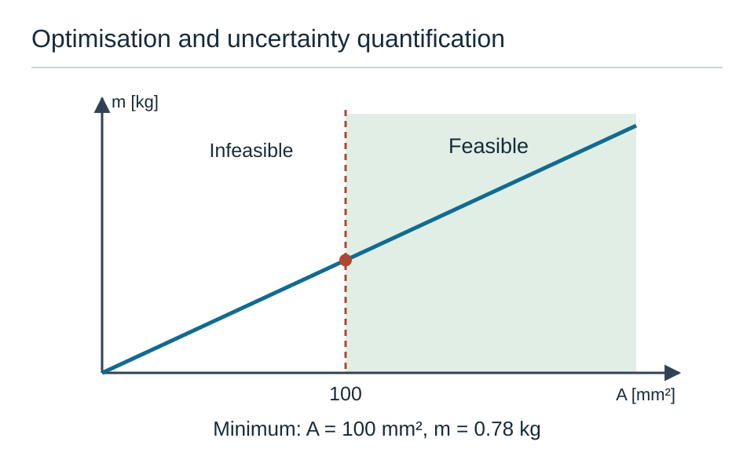

# M11-L5 – Optimisation and uncertainty quantification {#L5}

**Course area:** M11 – Simulation and numerical methods

**Level:** Master

**Prerequisites:** [M11-L4 – Multibody simulation](M11-L4.md)

**Learning objective:** Solve a constrained design problem and calculate uncertainty of a derived quantity.

## Introduction {#S1}

The lightest design is not automatically the best; requirements restrict feasible solutions.

## Foundations, concepts and model {#S2}

An optimisation problem consists of design variables x, objective $f(x)$ and constraints $g_i(x)\le0$, possibly with equalities $h_j(x)=0$. At a differentiable interior optimum without binding equality or inequality constraints, $\nabla f=0$; at an active boundary the slope can be nonzero. Under suitable regularity conditions, KKT conditions with nonnegative inequality multipliers provide necessary local optimality conditions. Nonconvex problems can have multiple local optima.

Uncertainty arises from loads, materials, manufacturing and measurement. For $y=f(x)$, linear uncertainty propagation gives $u_y^2\approx J\Sigma J^T$, where J is the gradient as a row vector and $\Sigma$ the covariance matrix. For independent inputs, cross terms vanish. Monte Carlo methods can represent nonlinearity and distributions but require justified inputs and convergence checks. Robust designs account for variations instead of optimising nominal values alone.

*Objective function with feasible region and active constraint.*

## Worked example {#S3}

A simplified tension bar with L = 1 m and ρ = 7800 kg/m³ is to minimise mass. With F = 10 kN and a hypothetical stress limit of 100 MPa, A ≥ F/σmax = 100 mm². Since m = ρLA increases monotonically, optimum mass is 0.78 kg. For stress σ = F/A with independent relative standard uncertainties uF/F = 2% and uA/A = 1%, uσ/σ ≈ √(0.02² + 0.01²) = 2.24%.

## Self-assessment {#S4}

### Exercises

1. What is the minimum area if force doubles?
2. Is the nominal design at the stress limit already robust?

::: {.lc-solutions data-lc-section="S4"}
### Solutions

1. 200 mm².
2. No, variations and other failure modes are not accounted for.
:::

## Assumptions and limitations {#S5}

Tension stress only and small independent input variations; not an actual design or reliability assessment.

## Summary and transition {#S6}

Optimisation requires constraints, uncertainties and assessment of model assumptions.

**Continue:** [M12-L1 – Fracture mechanics and life models](M12-L1.md)

## Sources {#S7}

- [MIT OCW – Nonlinear Programming](https://ocw.mit.edu/courses/6-252j-nonlinear-programming-spring-2003/pages/lecture-notes/) · Lecture index 2–6, 11–13: optimality and constraints; individual PDFs pending · Last accessed: 2026-11-25
- [NIST TN 1297 – Appendix A: Law of Propagation of Uncertainty](https://www.nist.gov/pml/nist-technical-note-1297/nist-tn-1297-appendix-law-propagation-uncertainty) · A.3: first-order Taylor approximation, sensitivities and covariance · Last accessed: 2026-11-25

