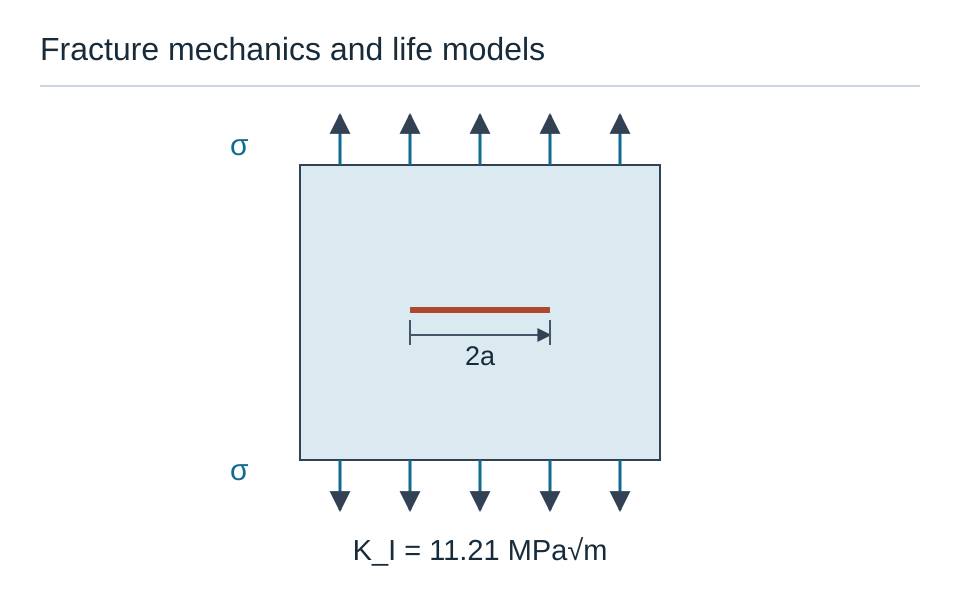

# M12-L1 – Fracture mechanics and life models {#L1}

**Course area:** M12 – Advanced design and materials

**Level:** Master

**Prerequisites:** [M2-L4 – Stress, strain and tension](M2-L4.md), [M5-L2 – First law and energy balances](M5-L2.md)

**Learning objective:** Calculate stress intensity and simplified fatigue crack growth.

## Introduction {#S1}

A component may fail at a pre-existing crack even at moderate nominal stress.

## Foundations, concepts and model {#S2}

Linear elastic fracture mechanics describes the singular crack-tip stress field through stress intensity factors. Mode I is opening, mode II in-plane shear and mode III out-of-plane shear. For mode I, $K_I=Y\sigma\sqrt{\pi a}$ with geometry factor Y and geometry-specific crack size a. With sufficiently small plastic zones and valid plane-strain conditions, $K_{IC}$ can serve as fracture toughness. Comparison with K_IC is not a complete component assessment.

In the intermediate regime of stable fatigue crack growth, the Paris model is $da/dN=C(\Delta K)^m$. C and m are experimentally determined and unit-dependent. Load ratio, threshold, crack closure, environment and rapid growth near fracture affect behaviour. A life estimate integrates $dN=da/[C(\Delta K(a))^m]$ between justified crack sizes. Constant ΔK is only a local approximation or a controlled special case.

*Plate with a central crack of length 2a under tensile stress.*

## Worked example {#S3}

For a central crack in an ideally infinite plate, Y = 1. With a = 4 mm (half crack length), σ = 100 MPa gives K_I = 11.21 MPa√m. Hypothetically let C = 10⁻¹² m/cycle/(MPa√m)³, m = 3 and constant ΔK = 10 MPa√m. Then da/dN = 10⁻⁹ m/cycle; 0.1 mm growth would correspond to 100,000 cycles under precisely this assumption.

## Self-assessment {#S4}

### Exercises

1. How does K_I change when crack size quadruples with unchanged Y?
2. Why is constant ΔK usually wrong at constant tensile stress amplitude?

::: {.lc-solutions data-lc-section="S4"}
### Solutions

1. It doubles.
2. Because ΔK increases with the square root of crack size when Y is constant.
:::

## Assumptions and limitations {#S5}

Ideal geometry, linear elastic regime, hypothetical material parameters; no inspection interval or approval can be derived.

## Summary and transition {#S6}

Crack size, loading and material toughness jointly determine fracture risk.

**Continue:** [M12-L2 – Nonlinear material models](M12-L2.md)

## Sources {#S7}

- [MIT OCW – Techniques for Structural Analysis and Design](https://ocw.mit.edu/courses/16-21-techniques-for-structural-analysis-and-design-spring-2005/pages/lecture-notes/) · Lecture index 34–42: fracture and fatigue; detailed lecture materials pending · Last accessed: 2026-11-25

