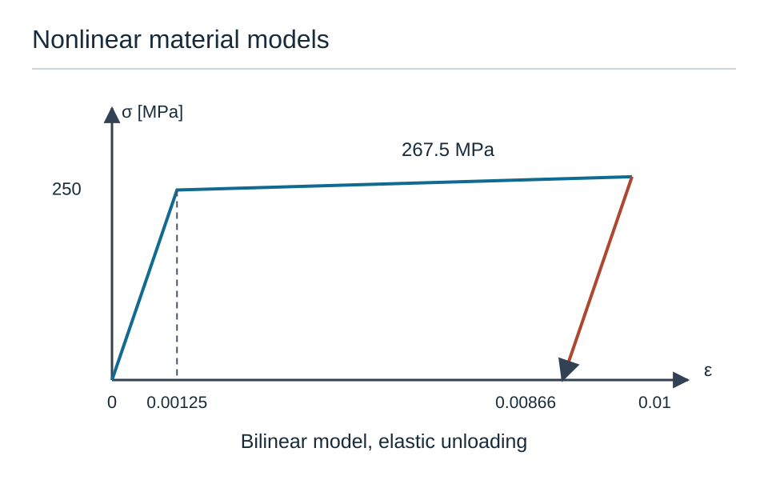

# M12-L2 – Nonlinear material models {#L2}

**Course area:** M12 – Advanced design and materials

**Level:** Master

**Prerequisites:** [M12-L1 – Fracture mechanics and life models](M12-L1.md)

**Learning objective:** Distinguish elastic, plastic and time-dependent material behaviour.

## Introduction {#S1}

A purely linear stiffness describes neither permanent deformation nor creep.

## Foundations, concepts and model {#S2}

A constitutive model relates stress and strain to state variables and possibly loading history. In the small uniaxial strain regime, $\epsilon=\epsilon_e+\epsilon_p$, $\sigma=E\epsilon_e$. A bilinear monotonic model has slope E up to $\epsilon_y=\sigma_y/E$ and tangent modulus $E_t$ thereafter: $\sigma=\sigma_y+E_t(\epsilon-\epsilon_y)$. The total-strain tangent modulus differs from the plastic hardening modulus; for linear isotropic hardening, $E_t=EH/(E+H)$. Unloading without further yielding occurs with elastic slope E.

Multiaxial plasticity requires a yield surface, flow rule and hardening law. Viscoelastic models combine elastic and viscous contributions; a Maxwell element consisting of a spring E and dashpot η in series exhibits $\sigma(t)=\sigma_0e^{-tE/\eta}$ at fixed strain. Viscoplasticity can additionally describe irreversible time-dependent deformation. Parameters must be identified from suitable tests and temperature ranges.

*Bilinear stress–strain diagram with elastic unloading.*

## Worked example {#S3}

E = 200 GPa, σy = 250 MPa, Et = 2 GPa, ε = 0.010. εy = 0.00125. σ = 250 + 2000·(0.010 − 0.00125) = 267.5 MPa. After elastic unloading to σ = 0, εp = 0.010 − 267.5/200,000 = 0.0086625 remains.

## Self-assessment {#S4}

### Exercises

1. What stress results with perfect plasticity (Et = 0) at the same final strain?
2. To what fraction does Maxwell stress fall after one relaxation time η/E?

::: {.lc-solutions data-lc-section="S4"}
### Solutions

1. 250 MPa.
2. 1/e ≈ 36.8%.
:::

## Assumptions and limitations {#S5}

Uniaxial small strain; no damage, rate or temperature effects in the bilinear example.

## Summary and transition {#S6}

Constitutive models need valid parameters and a description appropriate to the loading history.

**Continue:** [M12-L3 – Lightweight and composite structures](M12-L3.md)

## Sources {#S7}

- [MIT OCW – Mechanics and Materials II: Lecture Notes](https://ocw.mit.edu/courses/2-002-mechanics-and-materials-ii-spring-2004/pages/lecture-notes/) · Session 11 topic listing: elastic-plastic behaviour; individual equations not verified · Last accessed: 2026-11-25
- [MIT OCW – Mechanical Behavior of Plastics](https://ocw.mit.edu/courses/3-91-mechanical-behavior-of-plastics-spring-2007/) · Course description: viscoelasticity, composites and laminates, yield and fracture · Last accessed: 2026-11-25

