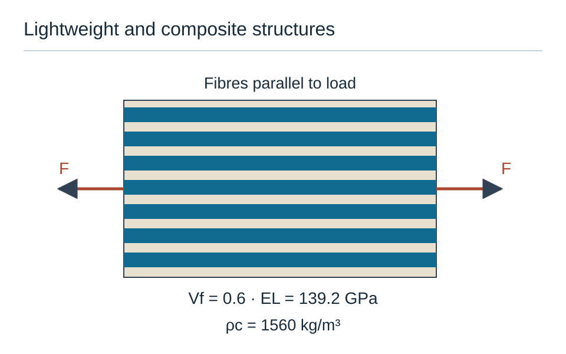

# M12-L3 – Lightweight and composite structures {#L3}

**Course area:** M12 – Advanced design and materials

**Level:** Master

**Prerequisites:** [M12-L2 – Nonlinear material models](M12-L2.md)

**Learning objective:** Estimate longitudinal stiffness and density of an ideal composite and classify anisotropic behaviour.

## Introduction {#S1}

Lightweight design reduces mass through load paths and section geometry as well as material choice.

## Foundations, concepts and model {#S2}

Specific stiffness E/ρ is one comparison parameter for axial loading; for bending or buckling appropriate performance indices change with geometry and constraints. For an ideal continuous fibre composite loaded along the fibres with equal strain in both phases, force addition gives $E_L=V_fE_f+(1-V_f)E_m$. Without voids, density is $\rho_c=V_f\rho_f+(1-V_f)\rho_m$. The fibre–matrix interface transfers loads; fibre orientation, waviness and voids affect properties.

A laminate consists of layers with different orientations. Classical laminate theory relates membrane forces and moments to mid-plane strains and curvatures via A, B and D matrices. Symmetric stacking eliminates the idealised membrane–bending coupling B. Transverse compression, shear, delamination, notches and impact require separate assessments; a high longitudinal modulus does not establish high transverse strength.

*Unidirectional fibre composite with parallel tensile loading and volume fractions.*

## Worked example {#S3}

Vf = 0.6, Ef = 230 GPa, Em = 3 GPa, ρf = 1800 kg/m³, ρm = 1200 kg/m³. EL = 0.6·230 + 0.4·3 = 139.2 GPa; ρc = 1560 kg/m³. EL/ρc ≈ 89.2·10⁶ m²/s². For hypothetical steel with 210 GPa and 7800 kg/m³ it is 26.9·10⁶ m²/s². The ratio of about 3.31 applies only to this axial comparison.

## Self-assessment {#S4}

### Exercises

1. What is EL at Vf = 0.5?
2. Can the longitudinal mixture rule be applied directly transverse to the fibres?

::: {.lc-solutions data-lc-section="S4"}
### Solutions

1. 116.5 GPa.
2. No, different stress and strain distributions require other models.
:::

## Assumptions and limitations {#S5}

Ideally aligned continuous fibres, perfect bonding, linear elasticity, no voids; not a strength certification.

## Summary and transition {#S6}

Lightweight design is a load-case-dependent system task, not a material ranking.

**Continue:** [M12-L4 – Systematic product development and reliability](M12-L4.md)

## Sources {#S7}

- [MIT OCW – Mechanical Behavior of Plastics](https://ocw.mit.edu/courses/3-91-mechanical-behavior-of-plastics-spring-2007/) · Course description: viscoelasticity, composites and laminates, yield and fracture · Last accessed: 2026-11-25

