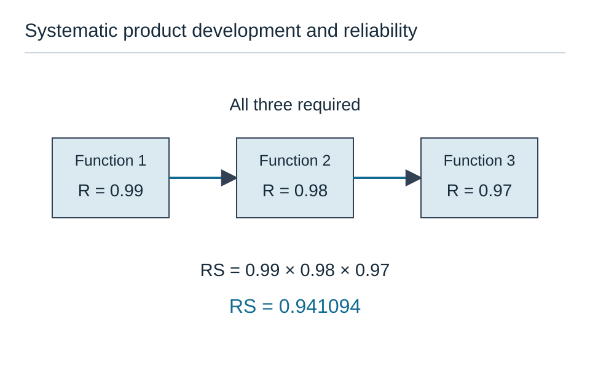

# M12-L4 – Systematic product development and reliability {#L4}

**Course area:** M12 – Advanced design and materials

**Level:** Master

**Prerequisites:** [M12-L3 – Lightweight and composite structures](M12-L3.md)

**Learning objective:** Translate requirements into verifiable functions and estimate system reliability.

## Introduction {#S1}

Product development is traceable only when requirements, design decisions and evidence fit together.

## Foundations, concepts and model {#S2}

Systematic development begins with a requirements list separating mandatory criteria from scored objectives. A functional structure describes inputs, outputs and subfunctions independently of specific components. Alternative physical principles are combined, evaluated and checked for compatibility. Scoring matrices make weights transparent but do not replace minimum requirements. Verification assigns evidence to each requirement; validation assesses whether the product fulfils its intended use.

Reliability $R(t)=P(T>t)$ describes the probability of surviving a defined time without specified failure. If every subsystem is required for function and failures are independent until the first failure, $R_S(t)=\prod_i R_i(t)$. Redundancy can create other logical structures; common causes such as power loss, overheating or software errors frequently violate independence. FMEA examines failure modes and effects; fault-tree analysis connects events logically. Safety-critical decisions need additional evidence.

*Three independent functions in a logical series configuration.*

## Worked example {#S3}

For a hypothetical 100 h mission, three required independent assemblies have R₁ = 0.99, R₂ = 0.98 and R₃ = 0.97. RS = 0.99·0.98·0.97 = 0.941094, or about 94.11%. Failure probability is 5.89%. Improving only R₃ to 0.99 gives RS = 0.960498.

## Self-assessment {#S4}

### Exercises

1. What reliability do two independent required components with R = 0.99 each have?
2. Why is a shared power supply a potential weakness of redundant assemblies?

::: {.lc-solutions data-lc-section="S4"}
### Solutions

1. 0.9801.
2. Its failure can disable both simultaneously.
:::

## Assumptions and limitations {#S5}

Fictitious probabilities, equal mission duration, independent first failures, no repair; no safety certification.

## Summary and transition {#S6}

Requirements, design decisions and reliability models must be connected by traceable evidence.

**Continue:** [M13-L1 – Turbomachinery](M13-L1.md)

## Sources {#S7}

- [MIT OCW – Introduction to Civil Engineering Design: Design Process](https://ocw.mit.edu/courses/1-012-introduction-to-civil-engineering-design-spring-2002/pages/projects/design_process/) · Design alternatives, decisions, outcomes and probabilistic sensitivity · Last accessed: 2026-11-25
- [NIST/SEMATECH e-Handbook – Series model](https://www.itl.nist.gov/div898/handbook/apr/section1/apr182.htm) · 8.1.8.2: independent components, first failure and product of survival probabilities · Last accessed: 2026-11-25

