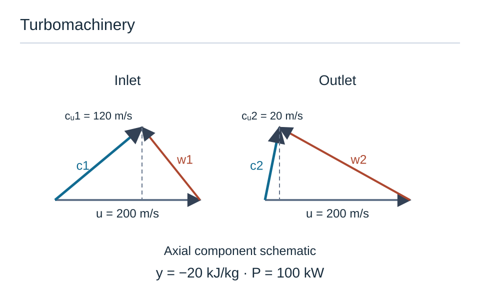

# M13-L1 – Turbomachinery {#L1}

**Course area:** M13 – Advanced energy and process engineering

**Level:** Master

**Prerequisites:** [M2-L4 – Stress, strain and tension](M2-L4.md), [M5-L2 – First law and energy balances](M5-L2.md)

**Learning objective:** Apply the Euler equation from angular momentum conservation and distinguish rotor work from stator action.

## Introduction {#S1}

Turbomachines transfer energy through continuously flowing blade rows.

## Foundations, concepts and model {#S2}

Take the positive tangential direction along rotation. Let $c_u$ be the tangential absolute velocity component, $u=\omega r$ the blade speed and $w=c-u$ the relative velocity (vector quantities). The steady angular momentum balance gives torque on the fluid $M=\dot m(r_2c_{u2}-r_1c_{u1})$. Multiplication by angular speed yields specific rotor work on the fluid $y=u_2c_{u2}-u_1c_{u1}$. For an adiabatic rotor this equals the change in stagnation enthalpy. In a turbine y is negative; the extracted power is $-\dot m y$.

A stator has u = 0. It may change swirl and static pressure but adds no shaft work. Efficiency requires a specified ideal reference process; Euler work alone does not determine pressure loss. Velocity triangles connect axial and tangential components and distinguish the stationary and rotating frames.

*Two velocity triangles of an axial turbine stage with decreasing swirl component.*

## Worked example {#S3}

An axial stage has u = 200 m/s, c_u1 = 120 m/s, c_u2 = 20 m/s and mass flow 5 kg/s. y = 200·(20 − 120) = −20 kJ/kg. Rotor output is 100 kW. At 100 rad/s the delivered torque is 1000 Nm.

## Self-assessment {#S4}

### Exercises

1. What is the power at 3 kg/s with unchanged velocities?
2. What follows if u and inlet and outlet swirl are identical?

::: {.lc-solutions data-lc-section="S4"}
### Solutions

1. 60 kW.
2. Euler work is zero; losses are still possible.
:::

## Assumptions and limitations {#S5}

Steady, averaged flow without additional torques; not blade design or a structural qualification.

## Summary and transition {#S6}

Blade speed times change in swirl determines the rotor energy balance.

**Continue:** [M13-L2 – Combustion and low-emission systems](M13-L2.md)

## Sources {#S7}

- [MIT Unified Engineering – The Euler Turbine Equation](https://ocw.mit.edu/ans7870/16/16.unified/propulsionS04/UnifiedPropulsion9/UnifiedPropulsion9.htm) · Section B: angular momentum, power and absolute velocities · Last accessed: 2026-11-25

