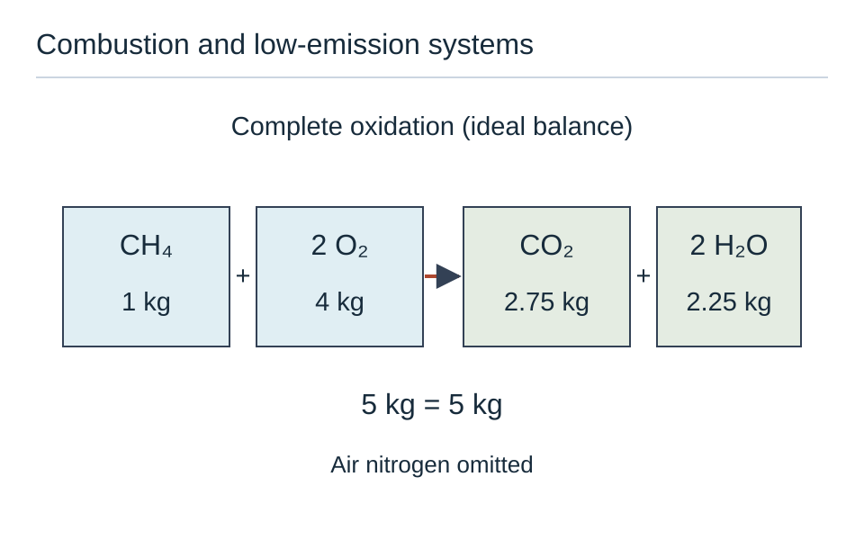

# M13-L2 – Combustion and low-emission systems {#L2}

**Course area:** M13 – Advanced energy and process engineering

**Level:** Master

**Prerequisites:** [M13-L1 – Turbomachinery](M13-L1.md)

**Learning objective:** Calculate stoichiometric amounts and air demand and identify the emission limits of the ideal model.

## Introduction {#S1}

Combustion couples chemical reactions, heat transfer, flow and pollutant formation.

## Foundations, concepts and model {#S2}

Complete methane oxidation follows $\mathrm{CH_4+2O_2\to CO_2+2H_2O}$. Coefficients are molar ratios. Using rounded molar masses of 16, 32, 44 and 18 g/mol, one kilogram of methane requires 4 kg oxygen and yields 2.75 kg carbon dioxide and 2.25 kg water. For a dry-air oxygen mass fraction of 0.232, the stoichiometric air demand is $L_{st}=4/0.232$. The air ratio $\lambda=L/L_{st}$ compares actual and stoichiometric air supply.

Element balances do not describe reaction rates. Real systems can produce CO through incomplete oxidation and nitrogen oxides whose formation depends in part on temperature and residence time. Exhaust treatment, heat recovery and alternative energy carriers are separate system options. Climate impact additionally requires upstream emissions and the useful energy actually delivered. Calculated CO₂ is not a complete emissions measurement.

*Stoichiometric methane balance showing reactant and product masses; no burner design.*

## Worked example {#S3}

For 1 kg methane, L_st ≈ 17.24 kg dry air. At an air ratio of 1.2 in a purely theoretical balance, air mass is 20.69 kg. Complete oxidation leaves 0.8 kg O₂; CO₂ mass remains 2.75 kg.

## Self-assessment {#S4}

### Exercises

1. How much CO₂ results from 2 kg of pure methane with complete oxidation?
2. Can NOx emissions be determined from air ratio alone?

::: {.lc-solutions data-lc-section="S4"}
### Solutions

1. 5.5 kg.
2. No; temperature history, kinetics, geometry and residence time are among the missing information.
:::

## Assumptions and limitations {#S5}

Pure material balance with rounded molar masses; no operating recommendations, ignition or experimental procedures, or regulatory compliance demonstration.

## Summary and transition {#S6}

Material balances and real emissions models serve different purposes.

**Continue:** [M13-L3 – Process engineering and mass transfer](M13-L3.md)

## Sources {#S7}

- [OpenStax Chemistry 2e – Writing and Balancing Chemical Equations](https://openstax.org/books/chemistry-2e/pages/4-1-writing-and-balancing-chemical-equations) · Section 4.1: methane combustion stoichiometry · Last accessed: 2026-11-25
- [EPA – Report on Revisions to AP-42 Section 3.3](https://nepis.epa.gov/Exe/ZyPURL.cgi?Dockey=P100RH0G.TXT) · Sections 2.3 and 2.3.3: combustion emissions and CO formation; historical technical reference, not current limits · Last accessed: 2026-11-25

