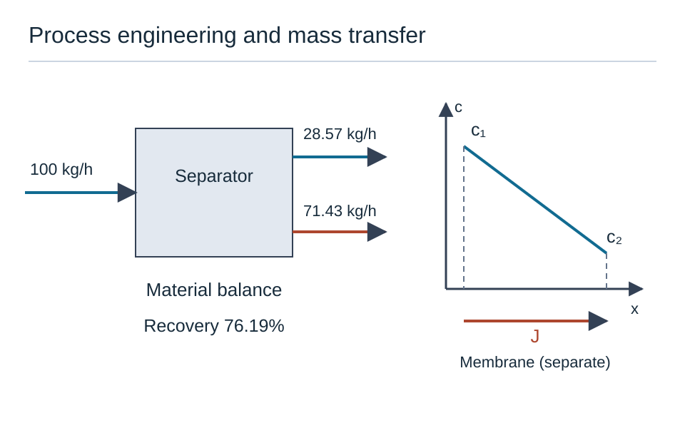

# M13-L3 – Process engineering and mass transfer {#L3}

**Course area:** M13 – Advanced energy and process engineering

**Level:** Master

**Prerequisites:** [M13-L2 – Combustion and low-emission systems](M13-L2.md)

**Learning objective:** Formulate total and component balances and estimate diffusion-limited mass flow.

## Introduction {#S1}

Process engineering designs transformations and separations using conservation and transport laws.

## Foundations, concepts and model {#S2}

For a steady nonreacting separator, $F=P+R$ and for component A, $Fx_F=Px_P+Rx_R$. F, P and R denote feed, product and reject mass flow rates; x denotes the respective mass fraction. Given compositions, $P=F(x_F-x_R)/(x_P-x_R)$. Recovery of A is $Px_P/(Fx_F)$. A balance alone does not explain the separation rate or energy requirement.

For one-dimensional diffusion without convection, Fick’s first law is $J=-D\,dc/dx$, with mass concentration c in kg/m³ and diffusivity D in m²/s. For constant D, a homogeneous flat layer of thickness L and a steady linear profile, $J=D(c_1-c_2)/L$. Mass flow is JA for area A. In multiphase processes, interfacial resistances, phase equilibrium and convection may limit transport.

*Material balance of a separator and linear concentration profile across a membrane.*

## Worked example {#S3}

F = 100 kg/h, x_F = 0.30, x_P = 0.80 and x_R = 0.10. P = 100·0.20/0.70 = 28.57 kg/h, R = 71.43 kg/h; recovery ≈ 76.19%. Separate membrane model: D = 2·10⁻¹⁰ m²/s, L = 0.001 m, Δc = 5 kg/m³, A = 0.2 m². J = 10⁻⁶ kg/(m² s), JA = 2·10⁻⁷ kg/s.

## Self-assessment {#S4}

### Exercises

1. How much A remains in the reject stream?
2. How does membrane flux change if thickness doubles and other quantities stay constant?

::: {.lc-solutions data-lc-section="S4"}
### Solutions

1. 7.14 kg/h.
2. It halves.
:::

## Assumptions and limitations {#S5}

Compositions are specified; no prediction of phase equilibrium, plant capacity or safety. The membrane and separator examples are independent.

## Summary and transition {#S6}

Balance equations constrain amounts; transport laws describe spatial and temporal transfer.

**Continue:** [M13-L4 – Sustainable energy conversion and integration](M13-L4.md)

## Sources {#S7}

- [LearnChemE / University of Colorado Boulder – Material Balances: Summary](https://learncheme.com/quiz-yourself/interactive-self-study-modules/material-balances/material-balances-summary/) · Key points: steady-state component and overall balances; independent equations · Last accessed: 2026-11-25 · Content verified: 2026-11-25
- [LearnChemE – Mass/Energy Balances](https://learncheme.com/screencasts/mass-energy-balances/) · Single and multiple unit balances; resource index only, videos not inspected · Last accessed: 2026-11-25
- [MIT OCW – STEM Concept Videos: Gradient](https://ocw.mit.edu/courses/res-tll-004-stem-concept-videos-fall-2013/resources/gradient/) · Summary and objectives: Fick’s first law and concentration gradient; video not viewed · Last accessed: 2026-11-25

