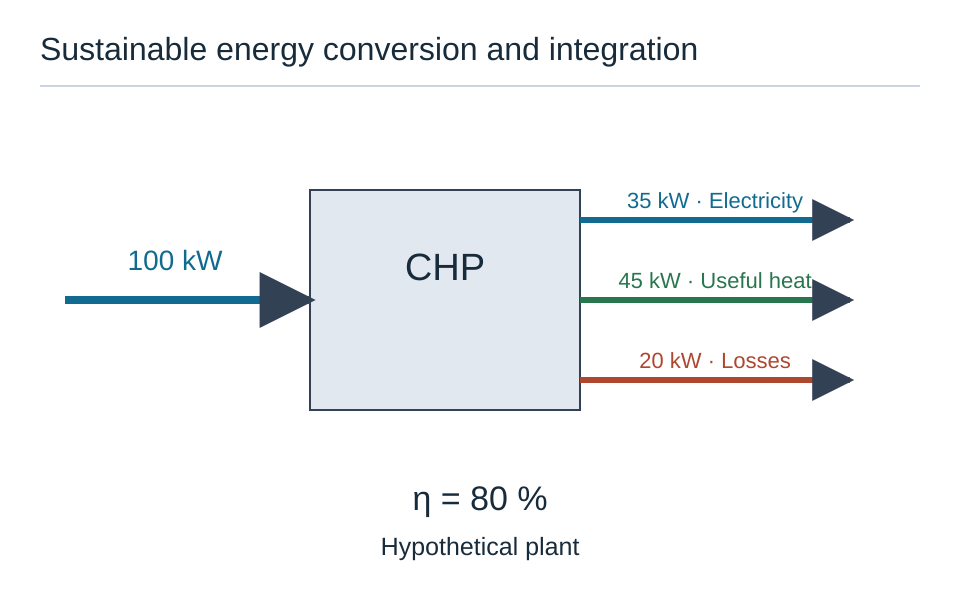

# M13-L4 – Sustainable energy conversion and integration {#L4}

**Course area:** M13 – Advanced energy and process engineering

**Level:** Master

**Prerequisites:** [M13-L3 – Process engineering and mass transfer](M13-L3.md)

**Learning objective:** Evaluate energy efficiency of integrated systems and the importance of actual heat utilisation.

## Introduction {#S1}

High plant efficiency matters only if the delivered energy can actually be used.

## Foundations, concepts and model {#S2}

Combined heat and power (CHP) supplies electricity and useful heat from a fuel input. On a consistent heating-value basis, utilisation is $\eta=(P_{el}+\dot Q_{use})/\dot E_{fuel}$. Electrical efficiency and the useful heat fraction can be reported separately. Heat that does not match demand, temperature or timing is not useful output.

For comparison with separate generation, use $\dot E_{sep}=P_{el}/\eta_{el,ref}+\dot Q_{use}/\eta_{heat,ref}$. This reference depends on the electrical system and heat source. Renewable electricity and heat pumps offer additional system options. A heat pump has $COP=\dot Q_{heat}/P_{el}$; COP above one does not violate energy conservation because heat is absorbed from the environment. Annual balances need varying loads, part-load operation, storage losses, grid imports and emission factors.

*Energy balance of combined heat and power showing useful heat, electricity and losses.*

## Worked example {#S3}

A model CHP consumes 100 kW fuel input and supplies 35 kW electricity and 45 kW useful heat. 20 kW leave the boundary unused. η = 80%. At reference efficiencies of 0.40 and 0.90, separate generation needs 35/0.40 + 45/0.90 = 137.5 kW. Modelled fuel savings are 27.27%.

## Self-assessment {#S4}

### Exercises

1. What is utilisation if only 20 kW heat is used?
2. How much electricity does a heat pump with COP 3 need for 45 kW heat?

::: {.lc-solutions data-lc-section="S4"}
### Solutions

1. 55%.
2. 15 kW; 30 kW are extracted from the heat source.
:::

## Assumptions and limitations {#S5}

Hypothetical reference efficiencies, steady load, no claim about actual climate impact or economics.

## Summary and transition {#S6}

Comparable system boundaries and time-matched useful energy are prerequisites for meaningful assessment.

**Continue:** [M14-L1 – Automated manufacturing and robot interfaces](M14-L1.md)

## Sources {#S7}

- [US Department of Energy – Combined Heat and Power Basics](https://www.energy.gov/cmei/ito/combined-heat-and-power-basics) · Definition and useful thermal output of CHP · Last accessed: 2026-11-25

