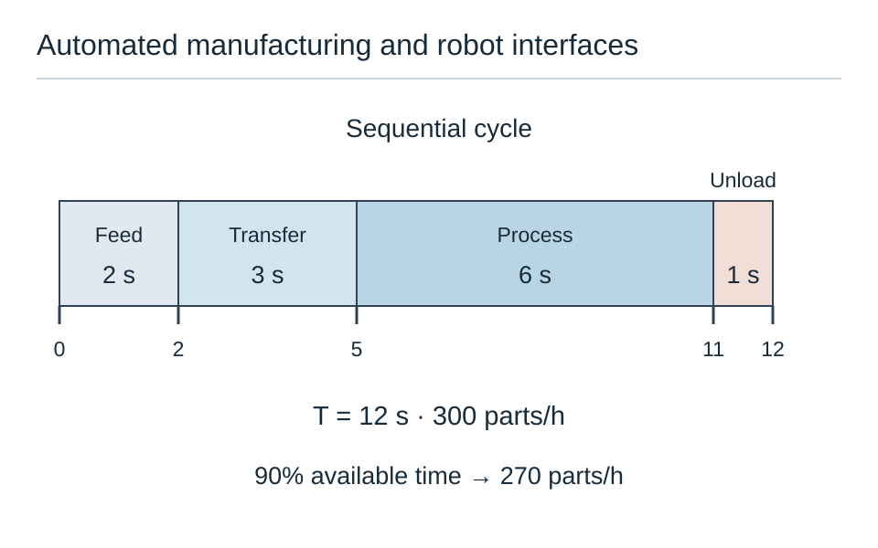

# M14-L1 – Automated manufacturing and robot interfaces {#L1}

**Course area:** M14 – Advanced manufacturing and digitalisation

**Level:** Master

**Prerequisites:** [M2-L4 – Stress, strain and tension](M2-L4.md), [M5-L2 – First law and energy balances](M5-L2.md)

**Learning objective:** Analyse a robot cell as a coupled system of mechanics, sequence control and safety.

## Introduction {#S1}

Automated cell productivity depends on more than robot speed.

## Foundations, concepts and model {#S2}

A geometric path $q(s)$ describes joint configurations along a normalised parameter s; time scaling $s(t)$ defines the trajectory $q(s(t))$. The chain rule gives $\dot q=q_s\dot s$ and $\ddot q=q_{ss}\dot s^2+q_s\ddot s$. Speed, acceleration, torque, reach and collisions constrain feasible motion. Gripping, feeding, sensors and controllers require coordinated states and unambiguous feedback.

A sequence model can distinguish ready, processing, complete and fault states. For a strictly sequential sequence, cycle time is $T_c=\sum_i t_i$; theoretical throughput with one part per cycle is $3600/T_c$ parts per hour when T_c is in seconds. Overlapping steps require dependency-based scheduling rather than simple addition. Safety functions must be separated from production handshakes and validated through risk assessment. A standard control signal alone does not establish safety.

*Timeline of a model robot cycle with sequential process stages.*

## Worked example {#S3}

A hypothetical cycle consists of feeding 2 s, transfer 3 s, processing 6 s and unloading 1 s. T_c = 12 s, theoretically 300 parts/h. An available time fraction of 90% with no other losses gives a long-run average of 270 parts/h.

## Self-assessment {#S4}

### Exercises

1. What is theoretical throughput if the process hypothetically takes 5 s?
2. May the faster calculated variant be implemented without renewed risk assessment?

::: {.lc-solutions data-lc-section="S4"}
### Solutions

1. 3600/11 ≈ 327.27 parts/h.
2. No; the model establishes neither safe motion nor safe integration.
:::

## Assumptions and limitations {#S5}

Timing model without actual robot parameters, no commissioning instructions, no standards or conformity assessment.

## Summary and transition {#S6}

Cycle optimisation and safety acceptance are separate tasks.

**Continue:** [M14-L2 – Digital twins and industrial data](M14-L2.md)

## Sources {#S7}

- [Northwestern – Modern Robotics: Point-to-Point Trajectories](https://modernrobotics.northwestern.edu/nu-gm-book-resource/9-1-and-9-2-point-to-point-trajectories-part-1-of-2/) · Transcript: path, time scaling, velocity and acceleration · Last accessed: 2026-11-25
- [OSHA Technical Manual – Industrial Robot Systems and Industrial Robot System Safety](https://www.osha.gov/otm/section-4-safety-hazards/chapter-4) · Risk assessment and safeguarding; not a current EU conformity assessment · Last accessed: 2026-11-25

