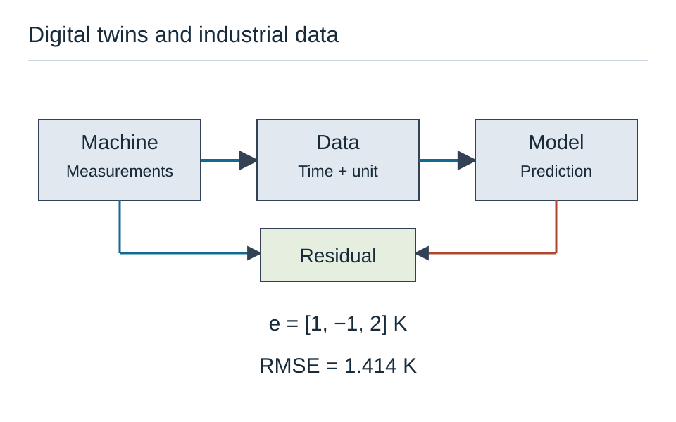

# M14-L2 – Digital twins and industrial data {#L2}

**Course area:** M14 – Advanced manufacturing and digitalisation

**Level:** Master

**Prerequisites:** [M14-L1 – Automated manufacturing and robot interfaces](M14-L1.md)

**Learning objective:** Distinguish digital twins from static models and quantitatively assess data quality.

## Introduction {#S1}

A digital twin connects a physical object or process to a synchronised digital model for specified purposes.

## Foundations, concepts and model {#S2}

A digital twin requires an identifiable asset, defined state variables, data connections, a model and an application. Measurements should carry units, timestamps, quality flags and asset identifiers. A static CAD file without data linkage is not by itself a synchronised twin. Diagnostics, prediction and virtual commissioning can require different model resolutions.

For N time-aligned reference measurements $y_i$ and model predictions $\hat y_i$, the residual is $e_i=y_i-\hat y_i$. Mean error is $\bar e=\sum e_i/N$, and root mean squared error is $RMSE=\sqrt{\sum e_i^2/N}$. Low RMSE does not guarantee suitability outside test data. With sample rate f in Hz and data age Δt, the application must check whether synchronisation and latency fit the process dynamics. Versioning models, calibration and data processing as well as access protection and failure behaviour are part of the architecture.

*Data flow from machine through timestamp and model to monitored residual.*

## Worked example {#S3}

Temperature readings [50, 52, 54] °C, model [49, 53, 52] °C. Residuals [1, −1, 2] K, mean 0.667 K, RMSE = √(6/3) ≈ 1.414 K. At 10 Hz and 0.5 s data age, the age corresponds to five sampling intervals.

## Self-assessment {#S4}

### Exercises

1. What is RMSE for three identical residuals of −2 K?
2. Why should validation be repeated after a process change?

::: {.lc-solutions data-lc-section="S4"}
### Solutions

1. 2 K; mean error is −2 K.
2. The previously tested model may be outside its validity domain.
:::

## Assumptions and limitations {#S5}

Synthetic data; three observations do not establish statistical model quality. No automated safety-critical control.

## Summary and transition {#S6}

Synchronisation, data provenance and purpose-specific validation matter as much as model accuracy.

**Continue:** [M14-L3 – Production logistics and optimisation](M14-L3.md)

## Sources {#S7}

- [NIST – Digital Twins for Advanced Manufacturing](https://www.nist.gov/programs-projects/digital-twins-advanced-manufacturing) · Synchronized models, interoperability, validation and uncertainty · Last accessed: 2026-11-25

