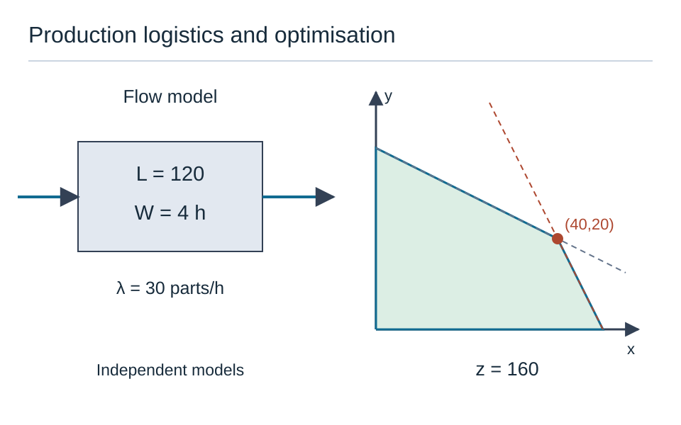

# M14-L3 – Production logistics and optimisation {#L3}

**Course area:** M14 – Advanced manufacturing and digitalisation

**Level:** Master

**Prerequisites:** [M14-L2 – Digital twins and industrial data](M14-L2.md)

**Learning objective:** Apply Little’s Law and formulate capacity optimisation with feasible constraints.

## Introduction {#S1}

Production logistics connects material flow, utilisation, inventory and delivery performance.

## Foundations, concepts and model {#S2}

For a consistently bounded stable process, long-run averages satisfy $L=\lambda W$, where L is the mean number of orders or parts in the system, λ is throughput and W is mean residence time. Units and populations must match. The relation does not require a particular processing-time distribution. By itself it does not predict how throughput or waiting time will respond to a changed inventory policy.

For capacity planning with two products x and y, a linear model can maximise contribution $z=c_xx+c_yy$. Resource constraints take the form $a_{jx}x+a_{jy}y\le b_j$. Nonnegativity, demand limits and possibly integrality are additional conditions. For a bounded feasible two-dimensional continuous linear programme, comparing vertices is sufficient when a solution exists. Setup times and stochastic demand may require different models.

*Production flow with inventory, throughput, mean flow time and two capacity limits.*

## Worked example {#S3}

With mean inventory 120 parts and throughput 30 parts/h, W = 4 h. Separate planning model: maximise 3x + 2y subject to 2x + y ≤ 100 and x + 2y ≤ 80, x,y ≥ 0. Vertices (0, 0), (50, 0), (40, 20), (0, 40) give z = 0; 150; 160; 80. Optimum (40, 20), z = 160 currency units.

## Self-assessment {#S4}

### Exercises

1. What mean inventory corresponds to 30 parts/h and 3 h flow time?
2. Which resources are fully used in the optimum plan?

::: {.lc-solutions data-lc-section="S4"}
### Solutions

1. 90 parts, provided the averages describe the same stable process.
2. Both: 2·40+20 = 100 and 40+2·20 = 80.
:::

## Assumptions and limitations {#S5}

Stable long-run averages; continuous deterministic planning model with hypothetical data. An inventory change is not guaranteed to preserve throughput.

## Summary and transition {#S6}

Flow metrics describe operation; optimisation models support decisions under explicit assumptions.

**Continue:** [M14-L4 – Maintenance and reliability](M14-L4.md)

## Sources {#S7}

- [University of Texas at Austin – Operations Management: Inventory](https://utw11041.utweb.utexas.edu/ORMM/omie/operation/unit/inventory/general.html) · Flow, inventory and time; Little’s law · Last accessed: 2026-11-25

