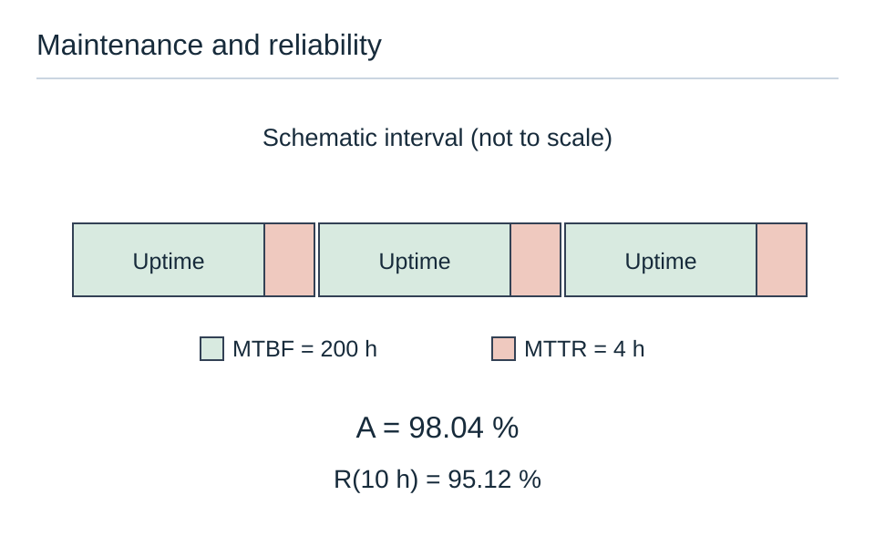

# M14-L4 – Maintenance and reliability {#L4}

**Course area:** M14 – Advanced manufacturing and digitalisation

**Level:** Master

**Prerequisites:** [M14-L3 – Production logistics and optimisation](M14-L3.md)

**Learning objective:** Distinguish failure rate, mean operating time and steady-state availability.

## Introduction {#S1}

Maintenance aims to manage risk and downtime consequences; maximising runtime alone is insufficient.

## Foundations, concepts and model {#S2}

For repairable equipment with n observed failures during total operating time T_up, a constant event intensity can be estimated by $\hat\lambda=n/T_{up}$. Here $MTBF=T_{up}/n$ explicitly denotes mean operating time between failures, excluding repair duration. MTTR is mean restoration time. Under an alternating renewal model with finite means and no additional downtime categories, long-run availability is $A=MTBF/(MTBF+MTTR)$. This time availability differs from the probability of completing a mission without failure.

For a constant conditional hazard during operation (exponentially distributed operating intervals), the probability of a failure-free interval t starting in an operational state is $R(t)=e^{-\lambda t}$. Wear and ageing may require a time-dependent rate. Condition-based maintenance uses observable features such as temperature or vibration trends; their utility depends on measurement quality, failure mode and prediction horizon. A maintenance strategy requires risk assessment, not just averages.

*Timeline of operating and repair intervals with calculated availability.*

## Worked example {#S3}

During 1000 operating hours, 5 failures and 20 h total restoration are observed. MTBF = 200 h, MTTR = 4 h, λ = 0.005 h⁻¹. Model availability A = 200/204 ≈ 98.04%. With constant λ, R(10 h) = exp(−0.05) ≈ 95.12%.

## Self-assessment {#S4}

### Exercises

1. What is A at MTTR = 2 h and unchanged MTBF?
2. Does an estimate based on five failures establish target availability with certainty?

::: {.lc-solutions data-lc-section="S4"}
### Solutions

1. 200/202 ≈ 99.01%.
2. No; sampling uncertainty, model assumptions and additional downtime categories must be considered.
:::

## Assumptions and limitations {#S5}

Constant failure intensity, alternating uptime and repair intervals, no preventive or logistical downtime. Not an actual maintenance instruction.

## Summary and transition {#S6}

Availability includes restoration; reliability concerns failure-free operation.

**Continue:** [M15-L1 – Vehicle and mobility systems](M15-L1.md)

## Sources {#S7}

- [NIST/SEMATECH – Homogeneous Poisson Process](https://www.itl.nist.gov/div898/handbook/apr/section1/apr171.htm) · 8.1.7.1: constant event rate, MTBF, Poisson model · Last accessed: 2026-11-25
- [NIST/SEMATECH – Constant repair rate model](https://www.itl.nist.gov/div898/handbook/apr/section4/apr451.htm) · 8.4.5.1: operating time divided by observed failures · Last accessed: 2026-11-25

