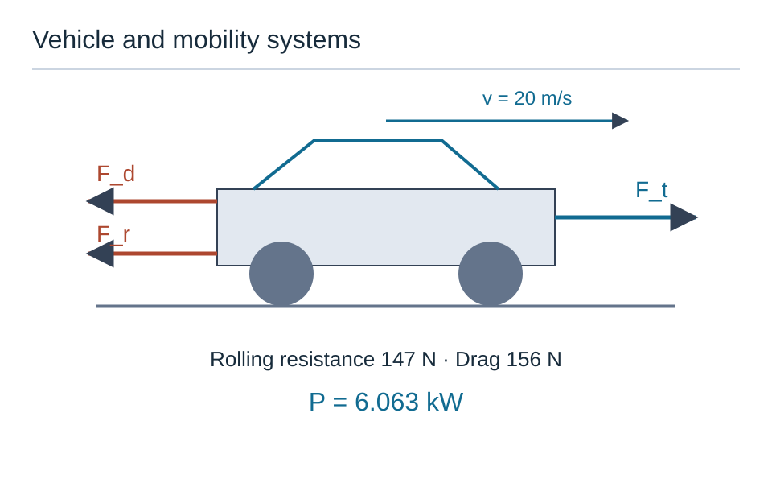

# M15-L1 – Vehicle and mobility systems {#L1}

**Course area:** M15 – Advanced application fields

**Level:** Master

**Prerequisites:** [M2-L4 – Stress, strain and tension](M2-L4.md), [M5-L2 – First law and energy balances](M5-L2.md)

**Learning objective:** Balance road loads and quantify the influence of speed on propulsion power.

## Introduction {#S1}

A vehicle must accelerate and also expend energy against road loads at constant speed. Propulsion technology alone therefore does not determine consumption.

## Foundations, concepts and model {#S2}

On a level road without wind, rolling resistance can be approximated by $F_r=c_rmg$ and aerodynamic drag by $F_d=\rho C_d A v^2/2$. Here $c_r$ is the rolling resistance coefficient, $C_d$ the drag coefficient referenced to frontal area A, and v speed. The longitudinal model is $F_t-F_r-F_d=ma$. On a slope of angle $\theta$, add $mg\sin\theta$ and include $\cos\theta$ in rolling resistance. Wheel power is $P=F_tv$. At steady speed the aerodynamic power component scales with the cube of speed. For an idealised drivetrain efficiency $\eta$, input power is $P/\eta$; regenerative braking needs its own balance. Driving cycles require time integration of power and auxiliary loads.

*Force balance of a vehicle on a level road and required wheel power.*

## Worked example {#S3}

m = 1500 kg, g = 9.81 m/s², c_r = 0.01, ρ = 1.2 kg/m³, C_d A = 0.65 m², v = 20 m/s. F_r = 147.15 N, F_d = 156 N; wheel power = 6063 W. At η = 0.9, input power is 6.74 kW.

## Self-assessment {#S4}

### Exercises

1. What is wheel power at 30 m/s?
2. How much wheel energy does the model require over 10 km at 20 m/s?

::: {.lc-solutions data-lc-section="S4"}
### Solutions

1.  (147.15 + 351)·30 = 14.94 kW.
2. 303.15 N · 10,000 m = 3.0315 MJ ≈ 0.842 kWh.
:::

## Assumptions and limitations {#S5}

Constant coefficients, no gusts, slope, rotational inertia or auxiliary loads; not an actual consumption assessment.

## Summary and transition {#S6}

Road loads and speed determine the mechanical energy and power balance.

**Continue:** [M15-L2 – Aerospace foundations](M15-L2.md)

## Sources {#S7}

- [NASA Glenn – Drag Equation](https://www1.grc.nasa.gov/beginners-guide-to-aeronautics/drag-equation/) · Drag coefficient and reference area · Last accessed: 2026-11-25
- [OpenStax – Work-Energy Theorem](https://openstax.org/books/university-physics-volume-1/pages/7-3-work-energy-theorem) · §7.3 work and kinetic energy · Last accessed: 2026-11-25
- [OpenStax – Newton’s Second Law](https://openstax.org/books/university-physics-volume-1/pages/5-3-newtons-second-law) · §5.3 net force and acceleration · Last accessed: 2026-11-25

