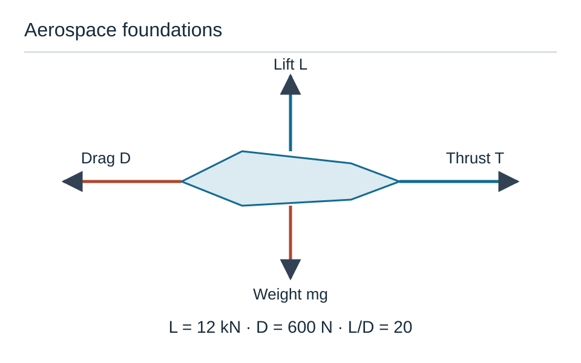

# M15-L2 – Aerospace foundations {#L2}

**Course area:** M15 – Advanced application fields

**Level:** Master

**Prerequisites:** [M15-L1 – Vehicle and mobility systems](M15-L1.md)

**Learning objective:** Explain aerodynamic coefficients, forces and orbital speed in separate models.

## Introduction {#S1}

Aeronautics and spaceflight operate under different conditions: flow dominates atmospheric loads, whereas gravity governs an idealised orbit.

## Foundations, concepts and model {#S2}

With dynamic pressure $q=\rho v^2/2$, lift is $L=qSC_L$ and drag $D=qSC_D$, referenced to the same area S. The dimensionless coefficients depend on geometry, angle of attack, Reynolds and Mach numbers, among other factors. In steady level flight with horizontal thrust, $L=mg$ and $T=D$; using the same reference area gives $L/D=C_L/C_D$. A high ratio alone does not establish performance or stability.

For an ideal circular orbit of a small body around a spherically symmetric central body, set $v^2/r=\mu/r^2$, where gravitational parameter $\mu=GM$. Thus $v=\sqrt{\mu/r}$ and $T_o=2\pi r/v$. Radius is measured from the centre, not the surface. These equations do not describe an actual launch or mission procedure.

*Forces in steady level flight and comparison of lift and drag.*

## Worked example {#S3}

ρ = 1.2 kg/m³, v = 50 m/s, S = 10 m², C_L = 0.8, C_D = 0.04. q = 1500 Pa, L = 12 kN, D = 600 N, L/D = 20. Separate model: μ = 3.986·10¹⁴ m³/s², r = 7·10⁶ m; circular speed ≈ 7.55 km/s, period ≈ 97.1 min.

## Self-assessment {#S4}

### Exercises

1. What mass would the lift support in steady level flight at g = 9.81 m/s²?
2. How does circular orbital speed change when r doubles?

::: {.lc-solutions data-lc-section="S4"}
### Solutions

1. 12000/9.81 ≈ 1223 kg.
2. It decreases to 1/√2 of its original value.
:::

## Assumptions and limitations {#S5}

Constant coefficients and steady flight; idealised two-body problem without perturbations. Not flight or mission approval.

## Summary and transition {#S6}

Flight forces and orbital mechanics require different models and reference quantities.

**Continue:** [M15-L3 – Plastics and textile engineering](M15-L3.md)

## Sources {#S7}

- [MIT OCW – Aerodynamics, Lecture 8: Equations of Aircraft Motion](https://ocw.mit.edu/courses/16-100-aerodynamics-fall-2005/678fcdd7f52560f148826442b6885f3e_16100lecture8_cg.pdf) · p. 3: dynamic pressure, reference area, lift and drag coefficients · Last accessed: 2026-11-25 · Content verified: 2026-11-25
- [NASA Glenn – Drag Equation](https://www1.grc.nasa.gov/beginners-guide-to-aeronautics/drag-equation/) · Drag coefficient and reference area · Last accessed: 2026-11-25
- [OpenStax – Newton’s Second Law](https://openstax.org/books/university-physics-volume-1/pages/5-3-newtons-second-law) · §5.3 net force and acceleration · Last accessed: 2026-11-25
- [OpenStax – Satellite Orbits and Energy](https://openstax.org/books/university-physics-volume-1/pages/13-4-satellite-orbits-and-energy) · 13.4: circular orbit equations 13.7 and 13.8 · Last accessed: 2026-11-25

