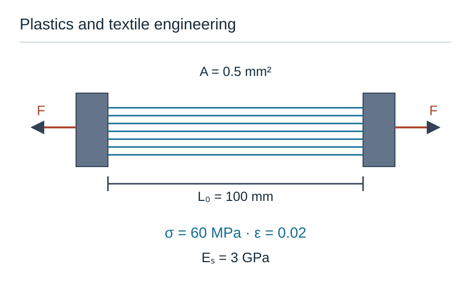

# M15-L3 – Plastics and textile engineering {#L3}

**Course area:** M15 – Advanced application fields

**Level:** Master

**Prerequisites:** [M15-L2 – Aerospace foundations](M15-L2.md)

**Learning objective:** Connect polymer processing to orientation, time dependence and fibre properties.

## Introduction {#S1}

Polymer products and textiles emerge from process chains that shape their final structure and performance.

## Foundations, concepts and model {#S2}

Thermoplastics soften when heated and can be extruded; cross-linked thermosets cannot be remelted in the same manner. Cooling and drawing during fibre manufacture influence molecular orientation. Fibres are processed into yarns and sheet structures whose properties cannot be inferred from polymer properties alone. Record temperature, moisture, strain rate and load duration in testing. For a homogeneous fibre cross-section A, nominal tensile stress is $\sigma=F/A$ and engineering strain is $\varepsilon=\Delta L/L_0$. Secant modulus $E_s=\sigma/\varepsilon$ is not necessarily tangent modulus. Viscoelastic materials can creep under constant stress and relax under constant strain. In fabrics distinguish actual fibre area, nominal specimen area and directional structure.

*Fibre tensile test and nominal stress from the load-bearing cross-section.*

## Worked example {#S3}

Idealised fibre bundle: A = 0.5 mm², F = 30 N, L₀ = 100 mm, ΔL = 2 mm. σ = 60 MPa, ε = 0.02, E_s = 3 GPa.

## Self-assessment {#S4}

### Exercises

1. What is σ at 45 N and unchanged area?
2. Why can the bundle modulus not be transferred directly to a fabric?

::: {.lc-solutions data-lc-section="S4"}
### Solutions

1. 90 MPa.
2. Fibre orientation, yarn geometry, porosity, contact and time-dependent deformation alter the response.
:::

## Assumptions and limitations {#S5}

Fictitious measurements and nominal area; not a material data sheet. Detailed process windows and textile testing standards are advanced topics.

## Summary and transition {#S6}

Process, structure, properties and testing form a connected chain.

**Continue:** [M15-L4 – Biomedical and microsystems engineering](M15-L4.md)

## Sources {#S7}

- [MIT OCW – Polymer Engineering](https://ocw.mit.edu/courses/3-064-polymer-engineering-fall-2003/) · Course description: selection, mechanical characterisation, processing · Last accessed: 2026-11-25
- [MIT Mechanical Engineering – Fiber and Textile Engineering](https://meche.mit.edu/featured-classes/fiber-and-textile-engineering) · Course scope: polymer science and fibrous media; not detailed constitutive equations · Last accessed: 2026-11-25
- [OpenStax – University Physics Volume 1, 12.3 Stress, Strain, and Elastic Modulus](https://openstax.org/books/university-physics-volume-1/pages/12-3-stress-strain-and-elastic-modulus) · §12.3: stress, strain, elastic modulus · Last accessed: 2026-11-25

