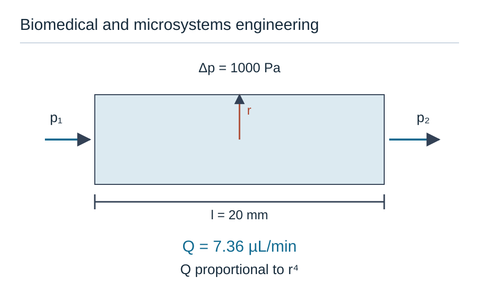

# M15-L4 – Biomedical and microsystems engineering {#L4}

**Course area:** M15 – Advanced application fields

**Level:** Master

**Prerequisites:** [M15-L3 – Plastics and textile engineering](M15-L3.md)

**Learning objective:** Calculate scaling effects in microsystems and distinguish technical from clinical validation.

## Introduction {#S1}

Biomedical engineering connects mechanics and materials with biological constraints; microsystems impose additional manufacturing and measurement requirements.

## Foundations, concepts and model {#S2}

A model for fully developed laminar flow of an incompressible Newtonian liquid in a rigid circular channel is $Q=\pi r^4\Delta p/(8\eta l)$. Hydraulic resistance $R_h=\Delta p/Q$ is highly sensitive to radius. Reynolds number $Re=\rho \bar v(2r)/\eta$, where $\bar v=Q/(\pi r^2)$, supports a plausibility check. In small channels, tolerances, surface forces, wetting and blockage can become decisive. The model does not automatically apply to blood or living tissue.

Technical verification checks specified quantities such as flow and leak tightness. Establishing that a medical device safely serves its clinical purpose also requires appropriate biological, clinical and regulatory evidence; a flow calculation cannot replace it. Document requirements, risks, test methods and acceptance limits separately during concept development.

*Idealised microchannel with pressure difference, radius and volume flow.*

## Worked example {#S3}

Water-like test liquid: η = 0.001 Pa·s, ρ = 1000 kg/m³, r = 50 µm, l = 0.02 m, Δp = 1000 Pa. Q ≈ 1.227·10⁻¹⁰ m³/s = 7.36 µL/min. Mean speed ≈ 0.0156 m/s; Re ≈ 1.56.

## Self-assessment {#S4}

### Exercises

1. How does Q change if radius decreases by 10%?
2. Does flow verification establish clinical effectiveness?

::: {.lc-solutions data-lc-section="S4"}
### Solutions

1. To 0.9⁴ = 65.61% of its initial value.
2. No. It checks only one technical requirement within the defined model or test.
:::

## Assumptions and limitations {#S5}

No medical application, dosing or approval instructions; idealised liquid and channel geometry.

## Summary and transition {#S6}

Scaling and measurable requirements are necessary but do not replace validation of intended use.

**Continue:** [M16-L1 – Safety, responsibility and sustainability](M16-L1.md)

## Sources {#S7}

- [OpenStax – Viscosity and Turbulence](https://openstax.org/books/university-physics-volume-1/pages/14-7-viscosity-and-turbulence) · §14.7: laminar flow and Poiseuille law · Last accessed: 2026-11-25
- [NIST/SEMATECH e-Handbook – Approach to uncertainty](https://www.itl.nist.gov/div898/handbook/mpc/section5/mpc52.htm) · §2.5.2: type A and B, quadrature, expanded uncertainty · Last accessed: 2026-11-25
- [NASA Systems Engineering Handbook – Product Realization](https://www.nasa.gov/reference/5-0-product-realization/) · Sections 5.3–5.4: verification and validation · Last accessed: 2026-11-25

