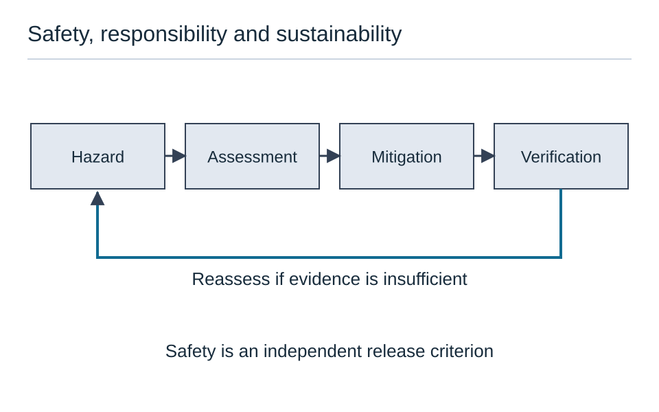

# M16-L1 – Safety, responsibility and sustainability {#L1}

**Course area:** M16 – Engineering practice and research project

**Level:** Bachelor / Master

**Prerequisites:** [M2-L4 – Stress, strain and tension](M2-L4.md), [M5-L2 – First law and energy balances](M5-L2.md)

**Learning objective:** Integrate safety, environmental and responsibility considerations systematically into engineering decisions.

## Introduction {#S1}

A low-cost, high-performing design is inadequate if its risks are not controlled.

## Foundations, concepts and model {#S2}

A hazard is a potential source of harm; risk considers the likelihood and severity of possible harm. Document operating states, affected people, failure modes and uncertainties. Inherently safer design and technical safeguards take priority, supplemented by organisational controls and information. Record residual risks and necessary evidence. Missing evidence cannot justify release simply because of schedule or cost pressure.

Sustainability comparisons need a common functional unit, system boundaries and time horizon. For two options with manufacturing energy H and constant annual operating energy B, a simplified model gives $E(t)=H+Bt$. The intersection is $t=(H_2-H_1)/(B_1-B_2)$ when the denominator is nonzero. Energy demand is not equivalent to greenhouse gas emissions, resource demand or social impacts.

*Decision sequence from hazard identification through mitigation to renewed verification.*

## Worked example {#S3}

Option A needs 1000 kWh to manufacture and 500 kWh/year to operate; B needs 1600 kWh and 300 kWh/year. Intersection after 3 years, both 2500 kWh. After 5 years: A 3500 kWh, B 3100 kWh. Unresolved safety risks must be addressed independently of this balance.

## Self-assessment {#S4}

### Exercises

1. What is the difference after 2 years?
2. Can a failed safety verification be offset by an environmental benefit?

::: {.lc-solutions data-lc-section="S4"}
### Solutions

1. A: 2000 kWh, B: 2200 kWh; A uses 200 kWh less.
2. No. Safety requirements remain independent release criteria.
:::

## Assumptions and limitations {#S5}

Not a standards-compliant risk assessment or full life-cycle assessment. NSPE is professional ethical guidance, not German law.

## Summary and transition {#S6}

Responsibility requires traceable requirements, evidence and transparent limits.

**Continue:** [M16-L2 – Economics and project management](M16-L2.md)

## Sources {#S7}

- [NSPE – Code of Ethics for Engineers](https://www.nspe.org/career-growth/nspe-code-ethics-engineers) · Professional ethics; US professional guidance, not German law · Last accessed: 2026-11-25
- [NASA Systems Engineering Handbook – Product Realization](https://www.nasa.gov/reference/5-0-product-realization/) · Sections 5.3–5.4: verification and validation · Last accessed: 2026-11-25

