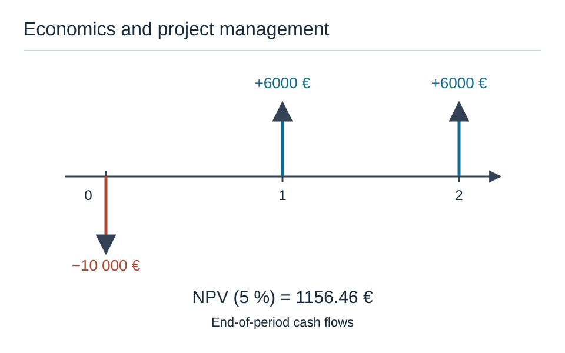

# M16-L2 – Economics and project management {#L2}

**Course area:** M16 – Engineering practice and research project

**Level:** Bachelor / Master

**Prerequisites:** [M16-L1 – Safety, responsibility and sustainability](M16-L1.md)

**Learning objective:** Use net present value and basic schedule dependencies to evaluate engineering projects.

## Introduction {#S1}

An engineering option must not only work but also be feasible under transparent economic and organisational assumptions.

## Foundations, concepts and model {#S2}

Investment net present value is $NPV=-I_0+\sum_{t=1}^n C_t/(1+i)^t$, where $I_0$ is the initial expenditure, $C_t$ net end-of-period cash flow and i the discount rate per period. Positive values suggest a return above the discount rate within the model. Compare alternatives using consistent lifetimes, residual values and risks. Sensitivity analysis varies uncertain inputs.

A work breakdown structure divides the work into verifiable deliverables. A network schedule represents dependencies: with parallel branches the longest dependent path initially governs earliest completion. Resource constraints may change the result. Milestones need measurable acceptance criteria. Assign risk owners and responses; log changes together with effects on cost, schedule and requirements.

*Cash-flow timeline with investment, returns and calculated net present value.*

## Worked example {#S3}

I₀ = €10,000, C₁ = C₂ = €6000, i = 5%. NPV = −10000 + 6000/1.05 + 6000/1.05² ≈ €1156.46. Separate network schedule: design 3 days, then parallel testing 4 and procurement 6 days, followed by integration 2 days; earliest completion 11 days.

## Self-assessment {#S4}

### Exercises

1. What is NPV at 10%?
2. What happens if testing increases to 7 days?

::: {.lc-solutions data-lc-section="S4"}
### Solutions

1. −10000 + 6000/1.1 + 6000/1.1² ≈ €413.22.
2. Testing becomes the critical branch, earliest completion after 12 days.
:::

## Assumptions and limitations {#S5}

Constant discount rates, simplified net cash flows without residual value or taxes; no resource constraints in the schedule.

## Summary and transition {#S6}

Economics and scheduling are models with testable assumptions, not guaranteed predictions.

**Continue:** [M16-L3 – Experimental design, data and reproducibility](M16-L3.md)

## Sources {#S7}

- [Cornell processdesign – Engineering economic analysis](https://design.cbe.cornell.edu/index.php?title=Engineering_economic_analysis) · Time Value of Money and Net Present Value sections · Last accessed: 2026-11-25
- [NASA Systems Engineering Handbook – Product Realization](https://www.nasa.gov/reference/5-0-product-realization/) · Sections 5.3–5.4: verification and validation · Last accessed: 2026-11-25

