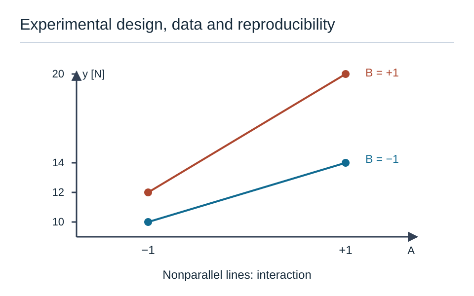

# M16-L3 – Experimental design, data and reproducibility {#L3}

**Course area:** M16 – Engineering practice and research project

**Level:** Bachelor / Master

**Prerequisites:** [M16-L2 – Economics and project management](M16-L2.md)

**Learning objective:** Plan factorial experiments, calculate main effects and interaction, and preserve raw data.

## Introduction {#S1}

Changing only one parameter at a time can conceal effects that depend on another parameter.

## Foundations, concepts and model {#S2}

A full factorial design with k factors at two levels has $2^k$ combinations. Code factors as −1 and +1; specify the response with units and measurement method. For two factors A and B, a model is $y=\beta_0+\beta_A x_A+\beta_B x_B+\beta_{AB}x_Ax_B$. In a balanced design, each main effect is the difference between means at high and low factor levels; its coefficient is half that effect. The interaction effect is the difference of means for positive and negative products $x_Ax_B$. Randomised run order reduces confounding with temporal trends. Replication estimates dispersion; blocks can address nuisance variables. Record instruments, calibration, unchanged raw data, analysis code and versions.

*Two-factor experiment with four combinations and an interaction plot.*

## Worked example {#S3}

Fictitious response in N: (−,−) 10; (+,−) 14; (−,+) 12; (+,+) 20. Grand mean 14 N; A effect = (14+20)/2 − (10+12)/2 = 6 N; B effect = 4 N; AB effect = (10+20)/2 − (14+12)/2 = 2 N. β₀ = 14, β_A = 3, β_B = 2, β_AB = 1, all in N.

## Self-assessment {#S4}

### Exercises

1. How many runs are required with three factors and two repeats per combination?
2. Can pure measurement variation be estimated from the four unreplicated values?

::: {.lc-solutions data-lc-section="S4"}
### Solutions

1. 2³·2 = 16.
2. No. The full model has four parameters for four values and no residual degrees of freedom.
:::

## Assumptions and limitations {#S5}

No significance claim without a suitable error model and replication. Two levels do not reveal curvature.

## Summary and transition {#S6}

A good experimental design separates effects, interactions and uncertainty and keeps analysis reproducible.

**Continue:** [M16-L4 – Bachelor project: mechanical system](M16-L4.md)

## Sources {#S7}

- [NIST/SEMATECH – Full factorial designs](https://www.itl.nist.gov/div898/handbook/pri/section3/pri333.htm) · 5.3.3.3: full factorial design and run count · Last accessed: 2026-11-25
- [NIST TN 1297 – Appendix A: Law of Propagation of Uncertainty](https://www.nist.gov/pml/nist-technical-note-1297/nist-tn-1297-appendix-law-propagation-uncertainty) · A.3: first-order Taylor approximation, sensitivities and covariance · Last accessed: 2026-11-25
- [MIT CEE Communication Lab – Research Paper and Presentation](https://mitcommlab.mit.edu/cee/commkit/research-paper-and-presentation/) · Methods, results, discussion and limitations · Last accessed: 2026-11-25

