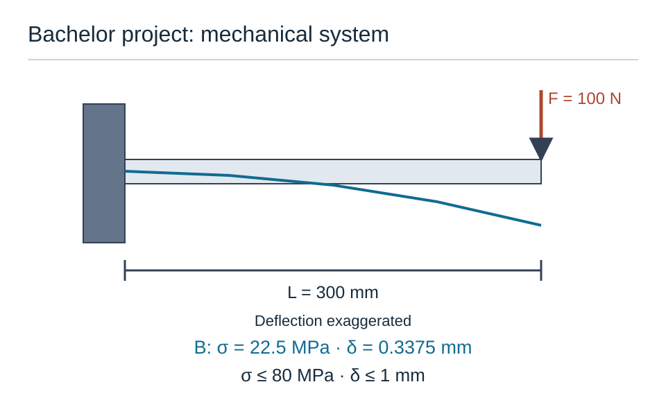

# M16-L4 – Bachelor project: mechanical system {#L4}

**Course area:** M16 – Engineering practice and research project

**Level:** Bachelor

**Prerequisites:** [M16-L3 – Experimental design, data and reproducibility](M16-L3.md)

**Learning objective:** Complete a mechanical bachelor-level project from requirements to documented concept verification.

## Introduction {#S1}

The project combines statics, material selection, CAD and testing. A simple cantilever serves as a purely analytical learning object.

## Foundations, concepts and model {#S2}

Brief: develop a concept for a teaching beam that deflects no more than 1 mm and reaches no more than 80 MPa nominal bending stress under a hypothetical 100 N end load at a free length of 300 mm. Compare at least two rectangular sections, assuming elastic modulus E = 200 GPa. For width b and height h, $I=bh^3/12$, $\sigma=FLh/(2I)$ and $\delta=FL^3/(3EI)$. Prepare a requirements table, free-body sketch, option matrix and parametric drawing. Verify both criteria separately; justify material assumptions and load case.

Deliverables: calculation sheet with units, dimensioned CAD model, comparison table, risk and assumption list, and plan for a safe supervised model test. Without suitable facilities, keep testing virtual; do not invent measurements. Rubric: requirements 20%, model and calculation 30%, option selection 20%, verification planning 20%, documentation 10%.

*Cantilever with test load and two calculated acceptance criteria.*

## Worked example {#S3}

Option A: b = 20 mm, h = 10 mm, I ≈ 1666.67 mm⁴, σ = 90 MPa, δ = 2.7 mm: fails both criteria. Option B: b = 20 mm, h = 20 mm, I ≈ 13333.33 mm⁴, σ = 22.5 MPa, δ = 0.3375 mm: passes both analytically.

## Self-assessment {#S4}

### Exercises

1. How do stress and deflection change when load doubles?
2. What additional evidence would an actual component require?

::: {.lc-solutions data-lc-section="S4"}
### Solutions

1. Both double in the linear model; B would have 45 MPa and 0.675 mm.
2. Actual material data, attachment verification, load spectrum, tolerances, failure modes and appropriate tests, among other evidence.
:::

## Assumptions and limitations {#S5}

Ideal clamp, linear elastic beam, static load; not construction instructions or approval of load-bearing parts.

## Summary and transition {#S6}

A project is complete when its defined learning requirements are addressed traceably and limitations documented.

**Continue:** [M16-L5 – Master project: simulation and validation](M16-L5.md)

## Sources {#S7}

- [MIT OCW – D-Lab II: Design Packet](https://ocw.mit.edu/courses/ec-720j-d-lab-ii-design-spring-2010/pages/projects/intro/) · Design stages and documentation · Last accessed: 2026-11-25
- [OpenStax – University Physics Volume 1, 12.3 Stress, Strain, and Elastic Modulus](https://openstax.org/books/university-physics-volume-1/pages/12-3-stress-strain-and-elastic-modulus) · §12.3: stress, strain, elastic modulus · Last accessed: 2026-11-25
- [MIT OCW – Mechanics & Materials I: Lecture Notes](https://ocw.mit.edu/courses/2-001-mechanics-materials-i-fall-2006/pages/lecture-notes/) · Lecture index, parts 1–8; individual PDFs pending · Last accessed: 2026-11-25
- [NASA Systems Engineering Handbook – Product Realization](https://www.nasa.gov/reference/5-0-product-realization/) · Sections 5.3–5.4: verification and validation · Last accessed: 2026-11-25

