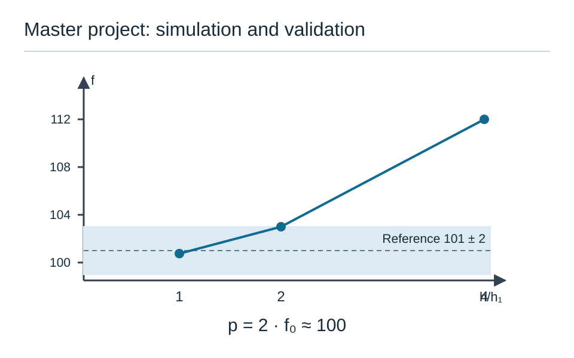

# M16-L5 – Master project: simulation and validation {#L5}

**Course area:** M16 – Engineering practice and research project

**Level:** Master

**Prerequisites:** [M16-L4 – Bachelor project: mechanical system](M16-L4.md)

**Learning objective:** Plan and analyse a master-level project with verification, uncertainty analysis and independent validation.

## Introduction {#S1}

The project investigates whether a numerical heat-conduction model is informative within a predefined application domain.

## Foundations, concepts and model {#S2}

Brief: model steady one-dimensional heat conduction in a homogeneous slab with prescribed boundary temperatures. Start with an analytical verification case, then use a separate suitable reference dataset for validation. For constant k, no sources and length L, $T(x)=T_0+(T_L-T_0)x/L$ and $q''=-k(T_L-T_0)/L$. Check energy conservation, units and implementation. In an additional case with a curved temperature profile, for example constant volumetric heat generation with constant k and prescribed boundary temperatures, examine at least three grids with constant refinement ratio r. For monotone asymptotic convergence with nonzero differences decreasing in magnitude under refinement, estimate $p=\ln|(f_3-f_2)/(f_2-f_1)|/\ln r$ with f₁ fine, f₂ medium, f₃ coarse. Numerical convergence alone does not validate a physical model.

Before comparison define a quantity of interest, acceptable error, and measurement and model uncertainties. Keep calibration and validation datasets separate. Deliverables: reproducible script, parameter file, grid study, reference data with provenance, residuals, uncertainty budget and discussion. Rubric: research question 15%, verification 25%, validation 25%, uncertainty 20%, reproducibility 15%.

*Grid convergence and independent comparison between model and reference value.*

## Worked example {#S3}

Analytical case: k = 10 W/(m K), L = 0.1 m, T₀ = 350 K, T_L = 300 K; q″ = 5000 W/m², T(0.05 m) = 325 K. Separate fictitious convergence example: f₃ = 112, f₂ = 103, f₁ = 100.75 (same unit), r = 2; p = ln(9/2.25)/ln 2 = 2. Richardson estimate f₀ ≈ 100. Fictitious independent reference value 101 ± 2: deviation of f₀ = −1; this alone does not establish general validation.

## Self-assessment {#S4}

### Exercises

1. What is analytical heat flux at twice the slab thickness?
2. Why is a calibration dataset not an independent validation dataset?

::: {.lc-solutions data-lc-section="S4"}
### Solutions

1. 2500 W/m² with other quantities unchanged.
2. Model parameters were fitted to those data; comparison can overestimate predictive performance.
:::

## Assumptions and limitations {#S5}

All example values are synthetic; no real experiment was performed. Apply the convergence formula only in an appropriate asymptotic regime.

## Summary and transition {#S6}

Verification examines the solution of the selected model; validation examines fitness for intended use.

**Continue:** [M16-L6 – Scientific writing and thesis](M16-L6.md)

## Sources {#S7}

- [NASA Glenn / NPARC – Conducting and Reporting a CFD Analysis](https://www.grc.nasa.gov/www/wind/TFAWS2007/Conducting-Reporting.pdf) · Slides Verification Assessment, Grid Convergence Study and Order of Convergence (20–24): verification, convergence order and Richardson extrapolation · Last accessed: 2026-11-25 · Content verified: 2026-11-25
- [NASA Systems Engineering Handbook – Product Realization](https://www.nasa.gov/reference/5-0-product-realization/) · Sections 5.3–5.4: verification and validation · Last accessed: 2026-11-25
- [NIST TN 1297 – Appendix A: Law of Propagation of Uncertainty](https://www.nist.gov/pml/nist-technical-note-1297/nist-tn-1297-appendix-law-propagation-uncertainty) · A.3: first-order Taylor approximation, sensitivities and covariance · Last accessed: 2026-11-25

