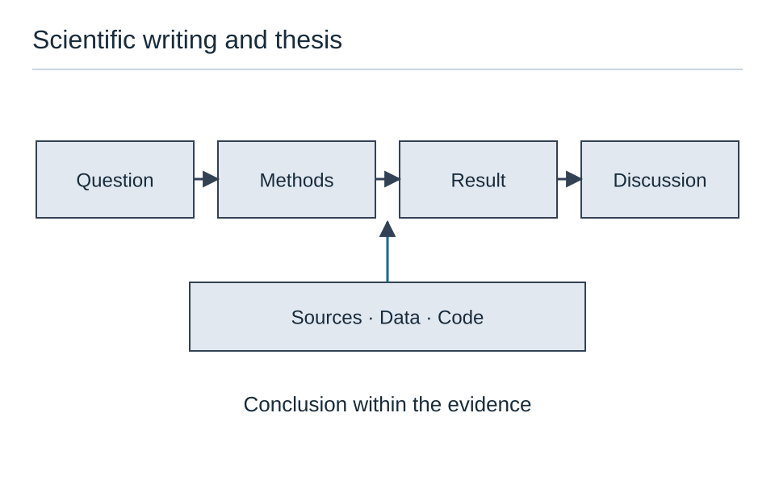

# M16-L6 – Scientific writing and thesis {#L6}

**Course area:** M16 – Engineering practice and research project

**Level:** Bachelor / Master

**Prerequisites:** [M16-L5 – Master project: simulation and validation](M16-L5.md)

**Learning objective:** Structure a scientific thesis with a transparent evidence trail, references and explicit limitations.

## Introduction {#S1}

A thesis is not an activity log but a reasoned contribution to a clear research question.

## Foundations, concepts and model {#S2}

Formulate a testable question, delimit the topic and distinguish existing knowledge from original work. The introduction motivates the question, literature review situates references, methods explain experimental or model choices and analysis, results report findings, and discussion examines significance, uncertainty and alternative explanations. Conclusions answer the question only within supported limits. Cite consulted sources with locations and distinguish paraphrases from quotations. Label synthetic data and tools; preserve data, code, parameters and versions where permitted.

For model value $y_m$ and reference value $y_r$, report $e=y_m-y_r$ and relative error $e/y_r$ if $y_r\ne0$. A single error value without measurement uncertainty, test conditions and sample size does not establish general accuracy. Create an evidence matrix linking claim, source or dataset, analysis step and limitation. Final exercise: write a short report on the bachelor or master project with abstract, question, methods, results, discussion, references and reproducibility appendix.

*Evidence chain from research question through data and analysis to a bounded conclusion.*

## Worked example {#S3}

Fictitious test point: model value 10.2 mm, reference 10.0 mm; e = 0.2 mm, relative error = 2%. Supported claim: the model overestimates this reference value by 0.2 mm under the stated conditions. Unsupported claim: the model is generally accurate to 2%.

## Self-assessment {#S4}

### Exercises

1. What is relative error for model value 9.5 mm and reference 10 mm?
2. Where do alternative explanations and model limitations belong in the thesis?

::: {.lc-solutions data-lc-section="S4"}
### Solutions

1. −5%; the model underestimates the reference.
2. Primarily in the discussion, with assumptions needed for understanding already stated in the methods.
:::

## Assumptions and limitations {#S5}

Not an institutional examination regulation or an actual thesis; formal requirements and rules on tool use must be checked separately.

## Summary and transition {#S6}

Scientific quality rests on traceable methods, testable claims and explicit limitations.

The planned study path ends here. Revisit the self-assessments and document your final project.

## Sources {#S7}

- [MIT CEE Communication Lab – Research Paper and Presentation](https://mitcommlab.mit.edu/cee/commkit/research-paper-and-presentation/) · Methods, results, discussion and limitations · Last accessed: 2026-11-25
- [NIST TN 1297 – Appendix A: Law of Propagation of Uncertainty](https://www.nist.gov/pml/nist-technical-note-1297/nist-tn-1297-appendix-law-propagation-uncertainty) · A.3: first-order Taylor approximation, sensitivities and covariance · Last accessed: 2026-11-25
- [NASA Systems Engineering Handbook – Product Realization](https://www.nasa.gov/reference/5-0-product-realization/) · Sections 5.3–5.4: verification and validation · Last accessed: 2026-11-25

