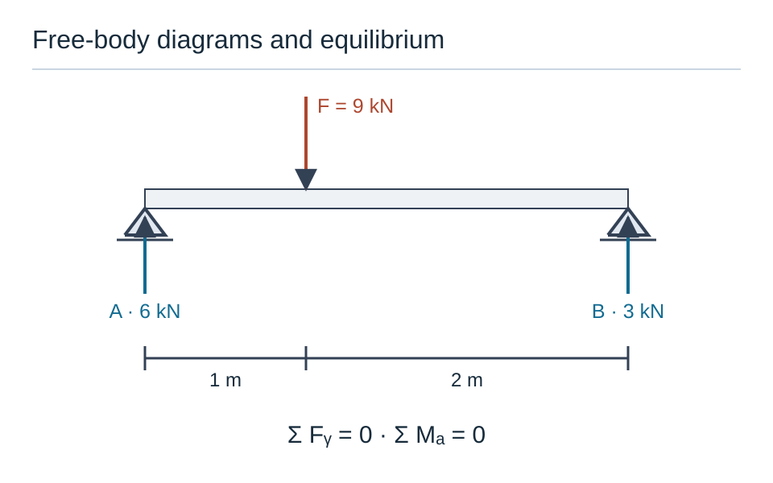

# M2-L1 – Free-body diagrams and equilibrium {#L1}

**Course area:** M2 – Statics and mechanics of materials

**Level:** Bachelor

**Prerequisites:** [M1-L1 – Units, scaling and dimensional analysis](M1-L1.md)

**Learning objective:** Draw a free-body diagram and apply the three planar equilibrium equations.

## Introduction {#S1}

A machine sits on a supporting beam. Before evaluating the strength of the beam, the forces transmitted to its supports must be known.

## Foundations, concepts and model {#S2}

A free-body diagram conceptually isolates the body under consideration. Removed connections are replaced by their force and, where appropriate, moment effects. Applied loads, self-weight and contact reactions are external forces; internal forces become visible only after a cut. An ideal planar pin support transmits two force components; a frictionless roller support transmits one reaction normal to its supporting surface. A fixed support can additionally transmit a moment.

For a stationary rigid body in an inertial frame, in the plane,

$$
\sum F_x=0,\quad \sum F_y=0,\quad \sum M_O=0.
$$

The moment reference point $O$ is freely selectable; choosing the point of application of an unknown force simplifies the equation. Positive moments are counterclockwise here. An initially negative calculated reaction indicates that the actual direction is opposite to the assumed arrow. For a unilateral contact, one must then check whether such a reaction is physically possible.

*Free-body diagram of a beam with a 9 kN point load and vertical reactions of 6 and 3 kN.*

## Worked example {#S3}

A 3 m beam is pinned at A on the left and roller-supported at B on the right. A vertical point load $F=9\,\mathrm{kN}$ acts 1 m to the right of A; self-weight is neglected. There is no horizontal load, hence $A_x=0$. Moment about A:

$$
3\,\mathrm m\cdot B_y-1\,\mathrm m\cdot9\,\mathrm{kN}=0.
$$

Thus $B_y=3\,\mathrm{kN}$ and vertical balance gives $A_y=9-3=6\,\mathrm{kN}$. Check about B: $-3\cdot6+2\cdot9=0\,\mathrm{kN\,m}$. The larger reaction occurs at the nearer support.

## Self-assessment {#S4}

### Exercises

1. Move the 9 kN load to the beam midpoint. What vertical reactions result?
2. Can an ideal roller resting freely on its support transmit a tensile force normal to the surface?

::: {.lc-solutions data-lc-section="S4"}
### Solutions

1. 4.5 kN each by symmetry and vertical equilibrium.
2. No; without a suitable restraint, the contact can lift off.
:::

## Assumptions and limitations {#S5}

Equilibrium does not guarantee load capacity or stability. The model neglects support stiffness, friction and deformation. Real load cases require consideration of self-weight, dynamic forces, permissible contact conditions and safety verification.

## Summary and transition {#S6}

Forces and moments on the whole system determine support reactions; next individual members are examined.

**Continue:** [M2-L2 – Support reactions and trusses](M2-L2.md)

## Sources {#S7}

- [OpenStax – University Physics Volume 1, 12.1 Conditions for Static Equilibrium](https://openstax.org/books/university-physics-volume-1/pages/12-1-conditions-for-static-equilibrium) · Kräfte- und Momentengleichgewicht, Schwerpunkt · Last accessed: 2026-11-25

