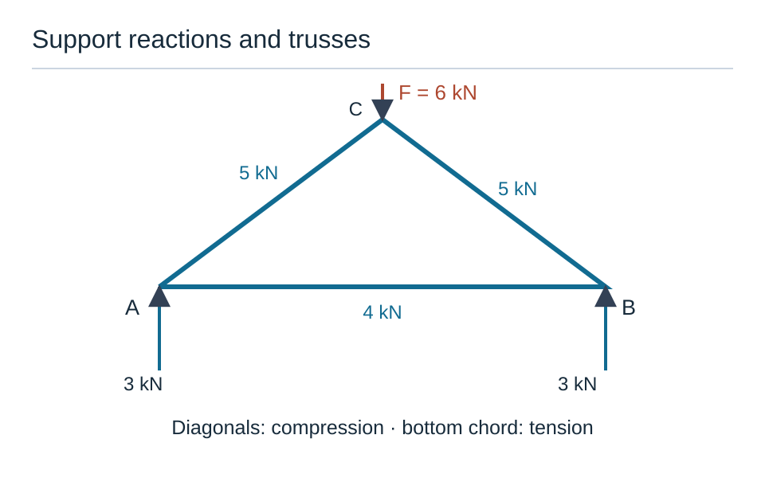

# M2-L2 – Support reactions and trusses {#L2}

**Course area:** M2 – Statics and mechanics of materials

**Level:** Bachelor

**Prerequisites:** [M2-L1 – Free-body diagrams and equilibrium](M2-L1.md)

**Learning objective:** Determine joint forces in an ideal planar truss using equilibrium.

## Introduction {#S1}

A lightweight machine frame can be modelled as a truss. Its geometry determines how an external load is distributed among tension and compression members.

## Foundations, concepts and model {#S2}

An ideal truss consists of straight members connected by pin joints. Loads act only at joints; member self-weight and bending are neglected or modelled separately. Each member is then a two-force member: end forces are equal, opposite and collinear. Tension is taken as positive by drawing force arrows away from an isolated joint. A negative result means compression.

First determine external support reactions using equilibrium of the complete structure. Each joint can then be treated as a point with $\sum F_x=\sum F_y=0$. Start at a joint with no more than two independent unknown member forces. Alternatively the method of sections calculates selected member forces using equilibrium of an isolated part. For a simple planar truss, $m+r=2j$ is a necessary counting condition for static determinacy (members $m$, reaction components $r$, joints $j$), but is not sufficient: the geometry may still be unstable.

*Symmetric triangular truss with compression diagonals, tension bottom chord and vertical apex load.*

## Worked example {#S3}

A triangular truss has $A=(0,0)$, $B=(8,0)$ and $C=(4,3)$ in metres. A is pinned and B roller-supported. A 6 kN load acts vertically downward at C. Symmetry and equilibrium give $A_y=B_y=3\,\mathrm{kN}$ and $A_x=0$. Both diagonals are 5 m long, so $\sin\theta=3/5$, $\cos\theta=4/5$.

At joint C both assumed diagonal tensile forces $N$ are equal by symmetry. Assumed tension directions point down towards A and B:

$$
-2N\cdot3/5-6\,\mathrm{kN}=0.
$$

Thus $N=-5\,\mathrm{kN}$, both diagonals are in compression. At joint A, horizontal equilibrium gives $N_{AB}+(-5)\cdot4/5=0$, so $N_{AB}=4\,\mathrm{kN}$ in tension. Vertically, $3-5\cdot3/5=0$.

## Self-assessment {#S4}

### Exercises

1. How do member forces change if the apex load doubles at unchanged geometry?
2. Why is a very shallow triangle unfavourable at the same apex load?

::: {.lc-solutions data-lc-section="S4"}
### Solutions

1. Diagonals 10 kN compression each, bottom chord 8 kN tension, supports 6 kN each.
2. At small sin θ, diagonal force magnitude must increase so its vertical component carries the same load.
:::

## Assumptions and limitations {#S5}

Real joints are often semi-rigid, forces may be eccentric and compression members can buckle. The truss approach is therefore a load model, not a final strength verification.

## Summary and transition {#S6}

Joint isolation yields axial forces; beams with bending loads require additional internal force resultants.

**Continue:** [M2-L3 – Internal forces and shear](M2-L3.md)

## Sources {#S7}

- [Engineering Statics – Method of Joints](https://engineeringstatics.org/method-of-joints.html) · Method of joints; planar truss equilibrium · Last accessed: 2026-11-25
- [OpenStax – University Physics Volume 1, 12.1 Conditions for Static Equilibrium](https://openstax.org/books/university-physics-volume-1/pages/12-1-conditions-for-static-equilibrium) · Kräfte- und Momentengleichgewicht, Schwerpunkt · Last accessed: 2026-11-25

