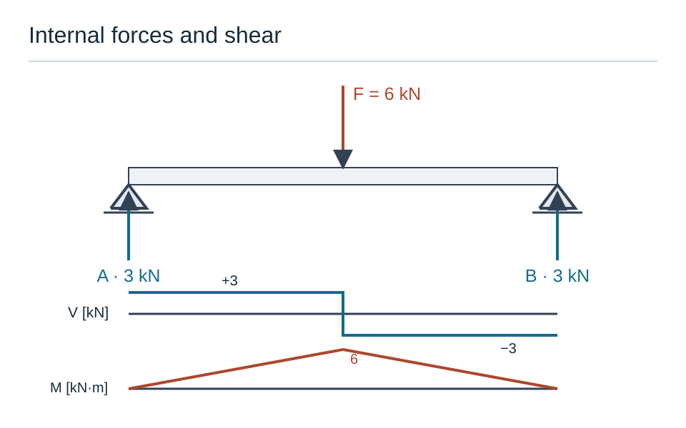

# M2-L3 – Internal forces and shear {#L3}

**Course area:** M2 – Statics and mechanics of materials

**Level:** Bachelor

**Prerequisites:** [M2-L2 – Support reactions and trusses](M2-L2.md)

**Learning objective:** Determine shear force and bending moment diagrams using section equilibrium.

## Introduction {#S1}

A beam may have a different bending moment at every location. Finding the most heavily loaded section requires the internal load distribution, not merely the support reactions.

## Foundations, concepts and model {#S2}

A cut perpendicular to the beam axis exposes the resultant internal forces and moments. In the planar model these are axial force $N$, shear force $V$ and bending moment $M$. For the left beam portion, positive $V$ acts downward at its right cut face and positive $M$ acts counterclockwise (sagging bending). A distributed load $q(x)$ positive downwards leads, in smooth regions with this convention, to

$$
\frac{\mathrm dV}{\mathrm dx}=-q(x),\qquad \frac{\mathrm dM}{\mathrm dx}=V(x).
$$

A point load causes a jump in the shear force diagram, but without an additional point couple the bending moment remains continuous. Under uniformly distributed load, $V$ is linear and $M$ quadratic. In an unloaded segment, $V$ remains constant and $M$ linear. A local moment extremum often occurs at $V=0$ or a sign change at a point load; boundary values must also be checked.

*Simply supported beam with central point load, stepped shear force and triangular bending moment.*

## Worked example {#S3}

A beam of length 4 m is pin- and roller-supported at its ends and loaded by 6 kN downward at its midpoint. The vertical reactions are 3 kN each. For $0<x<2\,\mathrm m$, $V=3\,\mathrm{kN}$ and $M=3\,\mathrm{kN}\cdot x$. For $2<x<4\,\mathrm m$, $V=-3\,\mathrm{kN}$ and

$$
M=3\,\mathrm{kN}\cdot x-6\,\mathrm{kN}\cdot(x-2\,\mathrm m).
$$

At $x=2\,\mathrm m$, the maximum moment is 6 kN·m. Both formulas yield the same value there. At the ideal end supports, $M=0$. With no axial load, $N=0$.

## Self-assessment {#S4}

### Exercises

1. Calculate M at x=1 m and x=3 m.
2. How does V change at the central point load?

::: {.lc-solutions data-lc-section="S4"}
### Solutions

1. 3 kN·m at each location.
2. It jumps from +3 kN to −3 kN, a change of −6 kN.
:::

## Assumptions and limitations {#S5}

Sign conventions differ across textbooks. Use one convention consistently and check boundary conditions. The one-dimensional beam model does not resolve local stress peaks at points of load introduction.

## Summary and transition {#S6}

Internal force resultants are inputs to stress and deformation calculations.

**Continue:** [M2-L4 – Stress, strain and tension](M2-L4.md)

## Sources {#S7}

- [Engineering Statics – Shear and Bending Moment Diagrams](https://engineeringstatics.org/VM_diagrams.html) · Shear and bending moment diagrams · Last accessed: 2026-11-25
- [University of Prince Edward Island – Engineering Mechanics: Statics](https://pressbooks.library.upei.ca/statics/) · Contents: chapters 5–6 on trusses and internal forces; detailed chapters pending · Last accessed: 2026-11-25

