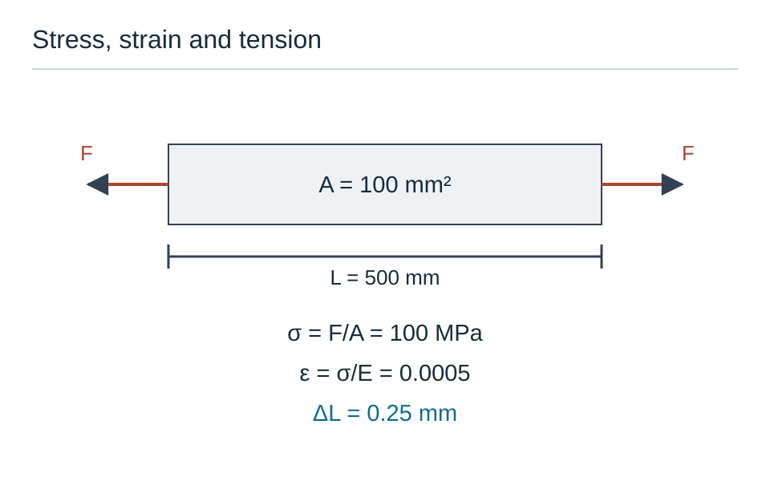

# M2-L4 – Stress, strain and tension {#L4}

**Course area:** M2 – Statics and mechanics of materials

**Level:** Bachelor

**Prerequisites:** [M2-L3 – Internal forces and shear](M2-L3.md)

**Learning objective:** Distinguish and calculate normal stress, strain and elastic elongation.

## Introduction {#S1}

Two tension bars can carry the same force but have different stresses and elongations. Force alone is not a material property.

## Foundations, concepts and model {#S2}

Engineering normal stress in a uniformly axially loaded bar is $\sigma=N/A_0$, where $A_0$ is its initial cross-section. Engineering strain is $\varepsilon=\Delta L/L_0$, where $L_0$ is its initial length. Tension is positive and compression negative. In the linear elastic range under uniaxial loading and constant conditions, Hooke's law is $\sigma=E\varepsilon$. Young's modulus $E$ measures stiffness in pascals, not a strength limit.

Substitution for constant cross-section and material gives

$$
\Delta L=\frac{NL_0}{EA_0},\qquad k=\frac{EA_0}{L_0}.
$$

The spring stiffness $k$ depends on component geometry as well as material stiffness. For piecewise constant properties and purely axial loading, add the signed elongations of each segment. Lateral strain under tension is described for isotropic linear elastic materials by Poisson's ratio $\nu$: $\varepsilon_y=-\nu\varepsilon_x$ for a free lateral direction.

*Tension bar with forces, cross-sectional area, gauge length and calculated elongation.*

## Worked example {#S3}

An idealised bar has $A_0=100\,\mathrm{mm^2}$, $L_0=500\,\mathrm{mm}$ and assumed modulus $E=200000\,\mathrm{N/mm^2}$. A tensile force of 10 kN causes $\sigma=10000/100=100\,\mathrm{MPa}$. The strain is $100/200000=0.0005$ or 0.05%. Elongation is $0.0005\cdot500=0.25\,\mathrm{mm}$. Spring stiffness is $200000\cdot100/500=40000\,\mathrm{N/mm}$. Check: $40000\cdot0.25=10000\,\mathrm N$.

## Self-assessment {#S4}

### Exercises

1. Double bar length at unchanged force, area and E. What changes?
2. Can the permissible tensile force be determined from E alone?

::: {.lc-solutions data-lc-section="S4"}
### Solutions

1. Stress and strain are unchanged; elongation doubles to 0.5 mm; stiffness halves.
2. No. Among other things, actual strength properties, cross-section, load case and safety concept are needed.
:::

## Assumptions and limitations {#S5}

The model assumes small strains and linear elasticity. It does not apply to plastic deformation, local notch stresses or strong temperature changes. The assumed E value is not a binding material specification.

## Summary and transition {#S6}

For axial loading stress is determined by area; bending additionally requires the distribution of area about the neutral axis.

**Continue:** [M2-L5 – Bending and deflection](M2-L5.md)

## Sources {#S7}

- [OpenStax – University Physics Volume 1, 12.3 Stress, Strain, and Elastic Modulus](https://openstax.org/books/university-physics-volume-1/pages/12-3-stress-strain-and-elastic-modulus) · §12.3: stress, strain, elastic modulus · Last accessed: 2026-11-25
- [MIT OCW – Mechanics of Materials (Fall 1999)](https://ocw.mit.edu/courses/3-11-mechanics-of-materials-fall-1999/) · Course Description; Spannung/Dehnung, Fachwerk, Torsion, Biegung; weiterführende Einzeltexte offen · Last accessed: 2026-11-25

