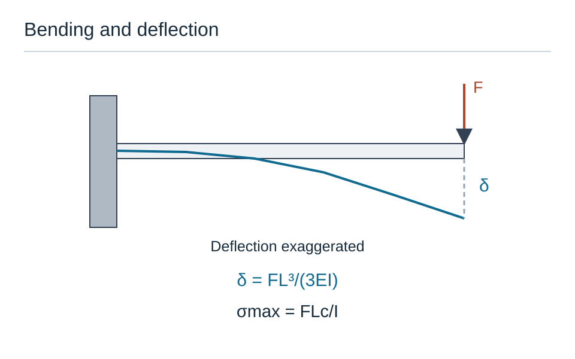

# M2-L5 – Bending and deflection {#L5}

**Course area:** M2 – Statics and mechanics of materials

**Level:** Bachelor

**Prerequisites:** [M2-L4 – Stress, strain and tension](M2-L4.md)

**Learning objective:** Calculate bending stress and deflection of a slender linear-elastic beam.

## Introduction {#S1}

A cantilevered tool holder can withstand a load without breaking and still deflect excessively. Strength and stiffness must be evaluated separately.

## Foundations, concepts and model {#S2}

Euler-Bernoulli beam theory assumes that plane cross-sections remain plane and perpendicular to the deformed beam axis. For homogeneous linear elasticity under pure bending, longitudinal strain varies linearly over the cross-section height. For coordinate $y$ measured from the neutral axis and second moment of area $I=\int_A y^2\,\mathrm dA$, an appropriate sign convention gives $\sigma_x=-My/I$. The maximum stress magnitude is $|M|c/I$, where $c$ is the largest distance from the neutral axis. For a rectangle with width $b$ and height $h$ in the bending direction, $I=bh^3/12$.

At small slopes curvature is proportional to $M/(EI)$. For a cantilever with end load $F$ and constant $EI$, integration of curvature under the clamped boundary conditions (zero displacement and slope) gives tip deflection magnitude $\delta=FL^3/(3EI)$. Maximum moment $FL$ occurs at the fixed support. The cube of height in the second moment of area explains why changing cross-section orientation can strongly affect bending stiffness.

*Cantilever beam with an end load and exaggerated deflection.*

## Worked example {#S3}

Consider an ideal cantilever with $L=300\,\mathrm{mm}$, $b=20\,\mathrm{mm}$, $h=40\,\mathrm{mm}$, $E=200000\,\mathrm{N/mm^2}$ and tip load $F=200\,\mathrm N$.

- $I=20\cdot40^3/12=106666.67\,\mathrm{mm^4}$.
- $M_\mathrm{max}=200\cdot300=60000\,\mathrm{N\,mm}$.
- $|\sigma_\mathrm{max}|=60000\cdot20/106666.67=11.25\,\mathrm{MPa}$.
- $\delta=200\cdot300^3/(3\cdot200000\cdot106666.67)\approx0.084375\,\mathrm{mm}$.

The small deflection relative to length is consistent with the small-deformation assumption but does not replace verification of the entire model.

## Self-assessment {#S4}

### Exercises

1. How does tip deflection change if length doubles and other quantities remain unchanged?
2. What happens to I when width and height are swapped (from 20 × 40 mm to 40 × 20 mm)?

::: {.lc-solutions data-lc-section="S4"}
### Solutions

1. It grows by a factor of eight. Maximum bending stress doubles.
2. The new value 40·20³/12 = 26666.67 mm⁴ is one quarter of the original value; deflection quadruples.
:::

## Assumptions and limitations {#S5}

Short or deep beams may exhibit significant shear deformation. Real clamps are not perfectly rigid; notches, load contact and fatigue require separate models. Numerical values are hypothetical. Detailed review of the linked lecture materials remains outstanding.

## Summary and transition {#S6}

Bending links moment and curvature; torsion links torque and twist.

**Continue:** [M2-L6 – Torsion and combined loading](M2-L6.md)

## Sources {#S7}

- [MIT OCW – Mechanics & Materials I: Lecture Notes](https://ocw.mit.edu/courses/2-001-mechanics-materials-i-fall-2006/pages/lecture-notes/) · Lecture index, parts 1–8; individual PDFs pending · Last accessed: 2026-11-25
- [MIT OCW – Unified Engineering: Materials and Structures: Lecture Notes](https://ocw.mit.edu/courses/16-001-unified-engineering-materials-and-structures-fall-2021/pages/lecture-notes/) · Lecture index: beam theory, torsion, buckling; individual files pending · Last accessed: 2026-11-25

