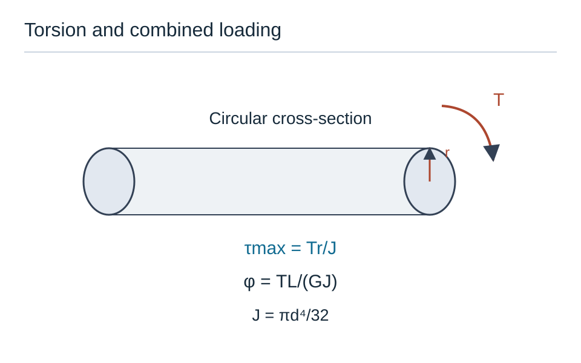

# M2-L6 – Torsion and combined loading {#L6}

**Course area:** M2 – Statics and mechanics of materials

**Level:** Bachelor

**Prerequisites:** [M2-L5 – Bending and deflection](M2-L5.md)

**Learning objective:** Determine shear stress and twist of a circular shaft and assess combined loading.

## Introduction {#S1}

A drive shaft transmits torque between a motor and a gearbox. In addition to torsion, gear and bearing forces can subject it to bending.

## Foundations, concepts and model {#S2}

For a straight homogeneous, isotropic, linear-elastic circular shaft under Saint-Venant torsion, $\gamma(r)=r\varphi/L$. With shear modulus $G$ and $\tau=G\gamma$, moment balance gives $T=\int_A \tau r\,\mathrm dA=G\varphi J/L$. Here $J=\int_A r^2\,\mathrm dA$ is the polar second moment of area. Thus

$$
\tau(r)=\frac{Tr}{J},\qquad \varphi=\frac{TL}{GJ}.
$$

For a solid circle of diameter $d$, $J=\pi d^4/32$; for a circular tube, $J=\pi(d_o^4-d_i^4)/32$. Isotropic linear-elastic material obeys $G=E/[2(1+\nu)]$. General noncircular cross-sections warp; their polar second moment of area cannot simply be used as the torsion constant.

For a pointwise superposed stress state consisting of longitudinal normal stress $\sigma$ and shear stress $\tau$, the von Mises equivalent stress is $\sigma_v=\sqrt{\sigma^2+3\tau^2}$. For appropriate ductile isotropic materials, it is used as a criterion for onset of yielding, not as a universal fracture or fatigue criterion.

*Circular shaft with torque, radius, maximum shear stress and angle of twist.*

## Worked example {#S3}

An idealised solid shaft has $d=20\,\mathrm{mm}$, $L=250\,\mathrm{mm}$ and $G=80000\,\mathrm{N/mm^2}$. Torque is $T=50\,\mathrm{N\,m}=50000\,\mathrm{N\,mm}$. Then $J=\pi\cdot20^4/32\approx15707.96\,\mathrm{mm^4}$. Maximum shear stress is $50000\cdot10/15707.96\approx31.83\,\mathrm{MPa}$. Twist is $50000\cdot250/(80000\cdot15707.96)\approx0.00995\,\mathrm{rad}$, about 0.570°. If an additional longitudinal normal stress of 60 MPa acts at the same surface point, $\sigma_v=\sqrt{60^2+3\cdot31.83^2}\approx81.48\,\mathrm{MPa}$. This is an equivalent stress, not component approval.

## Self-assessment {#S4}

### Exercises

1. How do maximum torsional stress and twist change when diameter doubles?
2. Where is shear stress zero in ideal solid circular torsion?

::: {.lc-solutions data-lc-section="S4"}
### Solutions

1. Since J grows with d⁴, surface stress falls to 1/8 and twist to 1/16.
2. At the shaft axis, r=0.
:::

## Assumptions and limitations {#S5}

The shaft calculation assumes small elastic deformation, circular cross-section and uniform load transfer. Shoulders, keyways, load cycles, bearing contact, critical speeds and temperature require further checks. Detailed review of the subject materials remains outstanding.

## Summary and transition {#S6}

Under compressive loading, stability failure may occur before material strength is reached.

**Continue:** [M2-L7 – Stability and buckling](M2-L7.md)

## Sources {#S7}

- [MIT OCW – Mechanics & Materials I: Lecture Notes](https://ocw.mit.edu/courses/2-001-mechanics-materials-i-fall-2006/pages/lecture-notes/) · Lecture index, parts 1–8; individual PDFs pending · Last accessed: 2026-11-25
- [MIT OCW – Unified Engineering: Materials and Structures: Lecture Notes](https://ocw.mit.edu/courses/16-001-unified-engineering-materials-and-structures-fall-2021/pages/lecture-notes/) · Lecture index: beam theory, torsion, buckling; individual files pending · Last accessed: 2026-11-25
- [MIT OCW – Mechanics of Materials (Fall 1999)](https://ocw.mit.edu/courses/3-11-mechanics-of-materials-fall-1999/) · Course Description; Spannung/Dehnung, Fachwerk, Torsion, Biegung; weiterführende Einzeltexte offen · Last accessed: 2026-11-25

