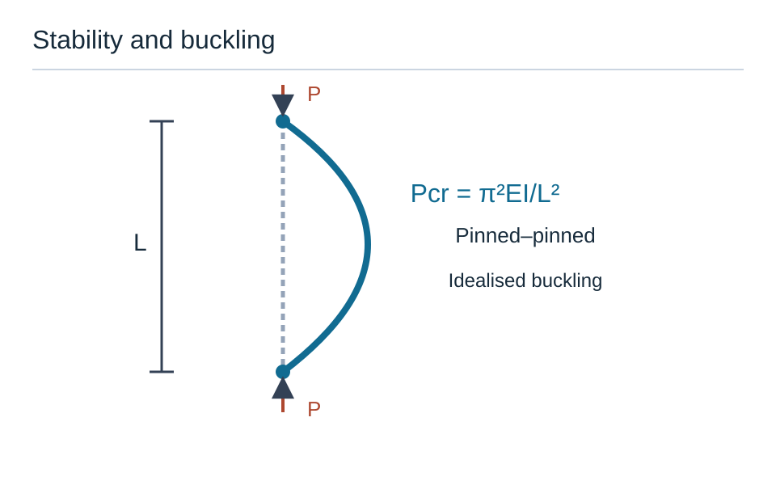

# M2-L7 – Stability and buckling {#L7}

**Course area:** M2 – Statics and mechanics of materials

**Level:** Bachelor

**Prerequisites:** [M2-L6 – Torsion and combined loading](M2-L6.md)

**Learning objective:** Derive the elastic Euler buckling load and distinguish it from material strength failure.

## Introduction {#S1}

A slender compression column can deflect laterally even when its average compressive stress remains well below yield strength. The failure concerns stability of the equilibrium state.

## Foundations, concepts and model {#S2}

For an ideally straight pin-ended column under centric compressive force $P>0$, the linearised buckling equation is $EIw''+Pw=0$. With $w(0)=w(L)=0$, nontrivial solutions $w=A\sin(n\pi x/L)$ exist only for $P_n=n^2\pi^2EI/L^2$. The lowest eigenload is for $n=1$

$$
P_\mathrm{cr}=\frac{\pi^2EI}{L^2}.
$$

For other idealised support conditions, replace $L$ with effective buckling length $KL$. The factor $K$ is about 1 for pinned–pinned and 2 for ideally fixed–free. Check the axis with the relevant smaller second moment of area if boundary conditions are the same. With radius of gyration $i=\sqrt{I/A}$, slenderness is $\lambda=KL/i$ and ideal buckling stress is $\sigma_\mathrm{cr}=\pi^2E/\lambda^2$.

The eigenload is not a permissible service load. With real imperfections lateral deflection occurs below the ideal eigenload. At low slenderness, plastic effects may dominate and invalidate the Euler model.

*Pin-ended compression column with an idealised lateral buckling mode.*

## Worked example {#S3}

An ideal column is 1000 mm long, pin-ended and has a rectangular cross-section $20\times10\,\mathrm{mm}$ with assumed $E=200000\,\mathrm{N/mm^2}$. About the weak axis, $I=20\cdot10^3/12=1666.67\,\mathrm{mm^4}$. Therefore

$$
P_\mathrm{cr}=\pi^2\cdot200000\cdot1666.67/1000^2\approx3290\,\mathrm N.
$$

For $A=200\,\mathrm{mm^2}$, this corresponds to about 16.45 MPa mean compressive stress. Slenderness is $1000/\sqrt{1666.67/200}\approx346.4$. The calculation illustrates the effect of geometry, not actual component load capacity.

## Self-assessment {#S4}

### Exercises

1. How does ideal buckling load change if length is halved?
2. How does it change at the same length for an ideally fixed–free instead of pinned–pinned column?

::: {.lc-solutions data-lc-section="S4"}
### Solutions

1. It quadruples, provided the Euler assumptions still hold.
2. With K=2 rather than K=1, it falls to one quarter.
:::

## Assumptions and limitations {#S5}

Euler theory assumes a slender, ideally straight, centrally loaded column with linear-elastic material and idealised supports. Imperfections, local buckling, residual stresses, eccentric loading, plastic buckling and safety requirements must be considered separately. Detailed review of the individual teaching materials remains outstanding.

## Summary and transition {#S6}

Static equilibrium, strength and stability models serve different purposes. The next topic block addresses motion and dynamics.

**Continue:** [M3-L1 – Motion and frames](M3-L1.md)

## Sources {#S7}

- [MIT OCW – Unified Engineering: Materials and Structures: Lecture Notes](https://ocw.mit.edu/courses/16-001-unified-engineering-materials-and-structures-fall-2021/pages/lecture-notes/) · Lecture index: beam theory, torsion, buckling; individual files pending · Last accessed: 2026-11-25
- [MIT OCW – Mechanics & Materials I: Lecture Notes](https://ocw.mit.edu/courses/2-001-mechanics-materials-i-fall-2006/pages/lecture-notes/) · Lecture index, parts 1–8; individual PDFs pending · Last accessed: 2026-11-25

