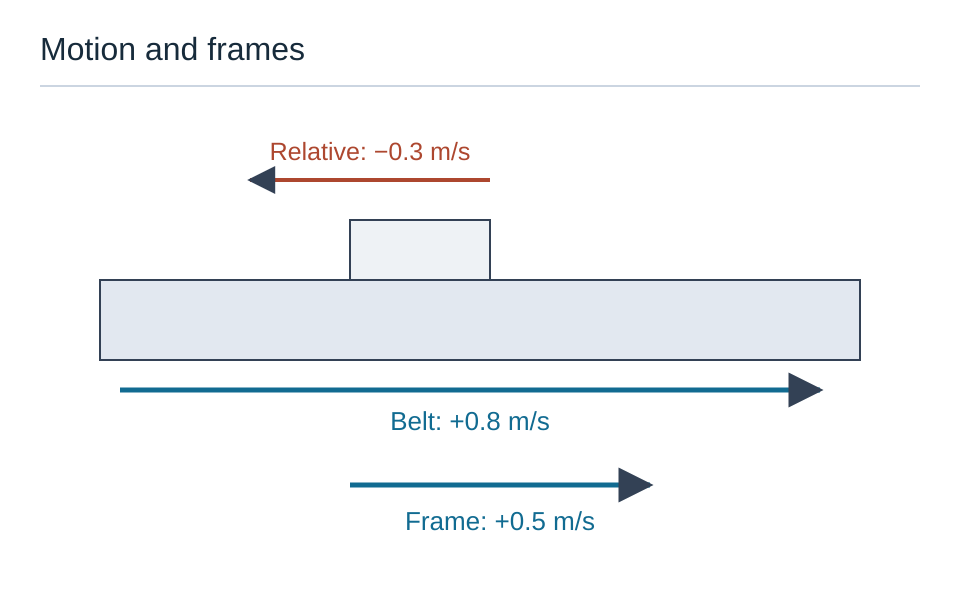

# M3-L1 – Motion and frames {#L1}

**Course area:** M3 – Kinematics and dynamics

**Level:** Bachelor

**Prerequisites:** [M1-L1 – Units, scaling and dimensional analysis](M1-L1.md)

**Learning objective:** Determine velocity and acceleration in explicitly named reference frames.

## Introduction {#S1}

A robot picks a part from a running conveyor. A camera on the frame and one on the belt observe different velocities. Both measurements can be correct.

## Foundations, concepts and model {#S2}

Position $\mathbf r(t)$ locates a point relative to an origin. Velocity and acceleration are $\mathbf v=d\mathbf r/dt$ and $\mathbf a=d\mathbf v/dt$. For one-dimensional constant acceleration, $x=x_0+v_0t+at^2/2$ and $v=v_0+at$. Distance travelled differs from signed displacement.

For two parallel, purely translating frames A and B, $\mathbf r_{P/A}=\mathbf r_{B/A}+\mathbf r_{P/B}$; differentiation gives velocity addition. With constant relative velocity the accelerations agree. Rotating frames introduce extra terms. Circular motion has inward acceleration even at constant speed: $a_n=v^2/r$.

*Velocity vectors of conveyor and component.*

## Worked example {#S3}

Belt velocity is 0.8 m/s rightward and part velocity relative to the belt is 0.3 m/s leftward. With right positive: 0.8 − 0.3 = 0.5 m/s relative to the frame. After 4 s the displacement is 2 m.

## Self-assessment {#S4}

### Exercises

1. A carriage starts from rest at 2 m/s². Distance after 3 s?
2. What normal acceleration occurs at 4 m/s and radius 2 m?

::: {.lc-solutions data-lc-section="S4"}
### Solutions

1. 9 m.
2. 8 m/s².
:::

## Assumptions and limitations {#S5}

No relativistic velocities; the simple addition rules assume non-rotating axes.

## Summary and transition {#S6}

Motion is first described geometrically. Forces then determine its change.

**Continue:** [M3-L2 – Newtonian equations of motion](M3-L2.md)

## Sources {#S7}

- [OpenStax – Relative Motion in One and Two Dimensions](https://openstax.org/books/university-physics-volume-1/pages/4-5-relative-motion-in-one-and-two-dimensions) · §4.5 relative motion · Last accessed: 2026-11-25
- [OpenStax – Motion in Two and Three Dimensions: Key Equations](https://openstax.org/books/university-physics-volume-1/pages/4-key-equations) · Ch. 4 velocity and reference frames · Last accessed: 2026-11-25

