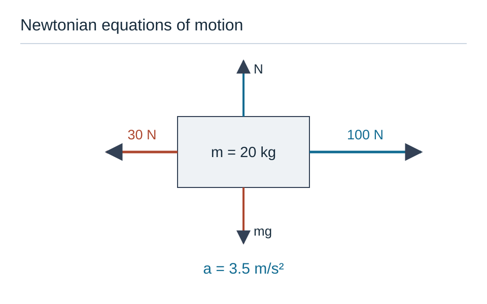

# M3-L2 – Newtonian equations of motion {#L2}

**Course area:** M3 – Kinematics and dynamics

**Level:** Bachelor

**Prerequisites:** [M3-L1 – Motion and frames](M3-L1.md)

**Learning objective:** Determine acceleration from a free-body diagram.

## Introduction {#S1}

A linear drive must overcome friction and its own moving mass as well as moving the payload.

## Foundations, concepts and model {#S2}

For a constant-mass body in an inertial frame, $\sum\mathbf F=m\mathbf a$. Draw only external forces acting on the isolated body. Weight and normal force can balance during horizontal motion although both exist. A Newton III force pair acts on different bodies and cannot be cancelled within a single free-body diagram.

In the simple Coulomb model, static friction adjusts to the applied load up to $\mu_s N$. During sliding, $F_R=\mu_kN$ approximately opposes relative motion. The x-direction equation is then, for example, $m\ddot x=F_A-F_R$. Initial conditions are needed to determine the trajectory.

*Force balance on a horizontal carriage.*

## Worked example {#S3}

An already sliding carriage (20 kg) is driven horizontally with 100 N. Friction is 30 N. Net force 70 N; acceleration 70/20 = 3.5 m/s². Vertical forces balance.

## Self-assessment {#S4}

### Exercises

1. What drive force maintains constant velocity with 30 N friction?
2. What acceleration does twice the mass have under the same net force of 70 N?

::: {.lc-solutions data-lc-section="S4"}
### Solutions

1. 30 N.
2. 1.75 m/s².
:::

## Assumptions and limitations {#S5}

Actual friction depends on speed, temperature and condition.

## Summary and transition {#S6}

The force balance gives instantaneous acceleration; energy and momentum balances offer alternative solution methods.

**Continue:** [M3-L3 – Work, energy and momentum](M3-L3.md)

## Sources {#S7}

- [OpenStax – Newton’s Second Law](https://openstax.org/books/university-physics-volume-1/pages/5-3-newtons-second-law) · §5.3 net force and acceleration · Last accessed: 2026-11-25

