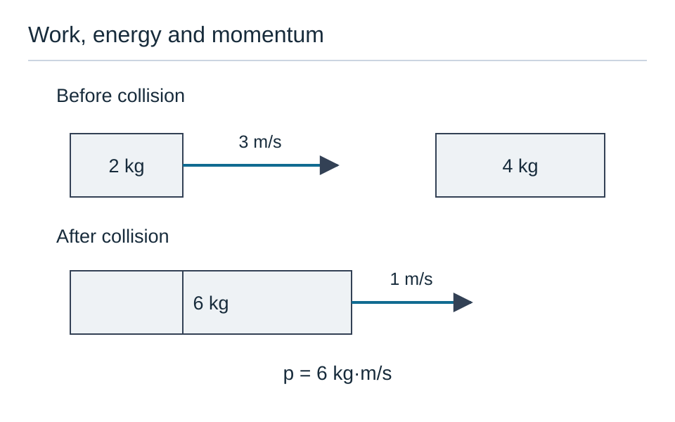

# M3-L3 – Work, energy and momentum {#L3}

**Course area:** M3 – Kinematics and dynamics

**Level:** Bachelor

**Prerequisites:** [M3-L2 – Newtonian equations of motion](M3-L2.md)

**Learning objective:** Distinguish energy and momentum and apply suitable conservation laws.

## Introduction {#S1}

Braking a machine requires removal of its kinetic energy. A short impact also involves momentum transfer.

## Foundations, concepts and model {#S2}

Mechanical work is $W=\int\mathbf F\cdot d\mathbf r$, and power $P=\mathbf F\cdot\mathbf v$. Net work on a particle equals $\Delta(mv^2/2)$. Conservative forces permit a potential-energy description; friction converts mechanical energy into other forms.

Momentum $\mathbf p=m\mathbf v$ is a vector. Impulse $\int\mathbf F\,dt$ is its change. For a system with no net external impulse, total momentum is conserved. In a perfectly inelastic collision the bodies move together afterwards; kinetic energy is not conserved, although total energy is.

*Momentum balance of two carts before and after an inelastic collision.*

## Worked example {#S3}

A 2 kg cart at 3 m/s couples to a stationary 4 kg cart. Total momentum 6 kg·m/s; common velocity 6/6 = 1 m/s. Initial kinetic energy 9 J, final 3 J. The difference, 6 J, is converted to deformation, heat and other internal energy forms.

## Self-assessment {#S4}

### Exercises

1. How much work does a constant 50 N force perform over 2 m in its direction?
2. What power does the same force deliver at 3 m/s in its direction?

::: {.lc-solutions data-lc-section="S4"}
### Solutions

1. 100 J.
2. 150 W.
:::

## Assumptions and limitations {#S5}

Real impacts require separate modelling of contact stiffness, impulse duration and geometry.

## Summary and transition {#S6}

Momentum conservation and kinetic-energy conservation have different conditions.

**Continue:** [M3-L4 – Rigid bodies and rotation](M3-L4.md)

## Sources {#S7}

- [OpenStax – Work-Energy Theorem](https://openstax.org/books/university-physics-volume-1/pages/7-3-work-energy-theorem) · §7.3 work and kinetic energy · Last accessed: 2026-11-25
- [OpenStax – Linear Momentum: Key Equations](https://openstax.org/books/university-physics-volume-1/pages/9-key-equations) · Ch. 9 momentum conservation · Last accessed: 2026-11-25

