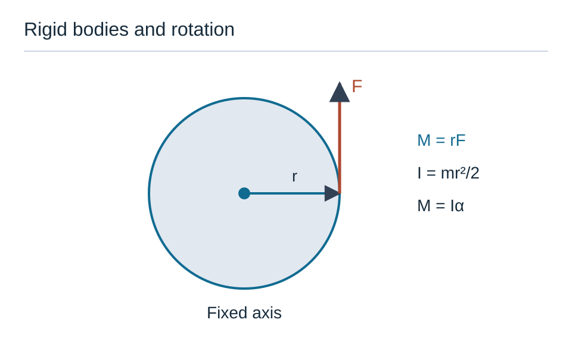

# M3-L4 – Rigid bodies and rotation {#L4}

**Course area:** M3 – Kinematics and dynamics

**Level:** Bachelor

**Prerequisites:** [M3-L3 – Work, energy and momentum](M3-L3.md)

**Learning objective:** Calculate moment of inertia, angular acceleration and rotational energy.

## Introduction {#S1}

A flywheel with mass concentrated near its rim stores more energy at the same mass and rotational speed than a compact hub.

## Foundations, concepts and model {#S2}

Angular velocity is $\omega=\dot\theta$ and angular acceleration $\alpha=\dot\omega$. In a rigid body, tangential speed depends on the distance to the axis: $v=\omega r$. For a fixed axis, $I=\int r^2\,dm$. A uniform solid disk has $I=mr^2/2$, an ideal thin ring $I=mr^2$. Inertia always refers to a specified axis.

A tangential force produces torque $M=rF$; in general the moment vector is $\mathbf r\times\mathbf F$. For constant mass geometry about a fixed axis, $\sum M=I\alpha$. Rotational energy is $I\omega^2/2$, and power about that axis is $M\omega$.

*Torque at the rim of a fixed-axis disk.*

## Worked example {#S3}

Solid disk 10 kg, radius 0.2 m: I = 0.2 kg·m². A constant net torque of 4 N·m produces 20 rad/s². After 2 s from rest: 40 rad/s and rotational energy 160 J.

## Self-assessment {#S4}

### Exercises

1. What inertia has a thin ring of the same mass and radius?
2. What power corresponds to 4 N·m at 40 rad/s?

::: {.lc-solutions data-lc-section="S4"}
### Solutions

1. 0.4 kg·m².
2. 160 W.
:::

## Assumptions and limitations {#S5}

The scalar equation applies to a fixed axis; general spatial motion requires the inertia tensor.

## Summary and transition {#S6}

Rotational dynamics extends translational equations with axis-dependent quantities.

**Continue:** [M3-L5 – Vibration and resonance](M3-L5.md)

## Sources {#S7}

- [OpenStax – Fixed-Axis Rotation: Key Equations](https://openstax.org/books/university-physics-volume-1/pages/10-key-equations) · Ch. 10 torque, inertia and kinetic energy · Last accessed: 2026-11-25

