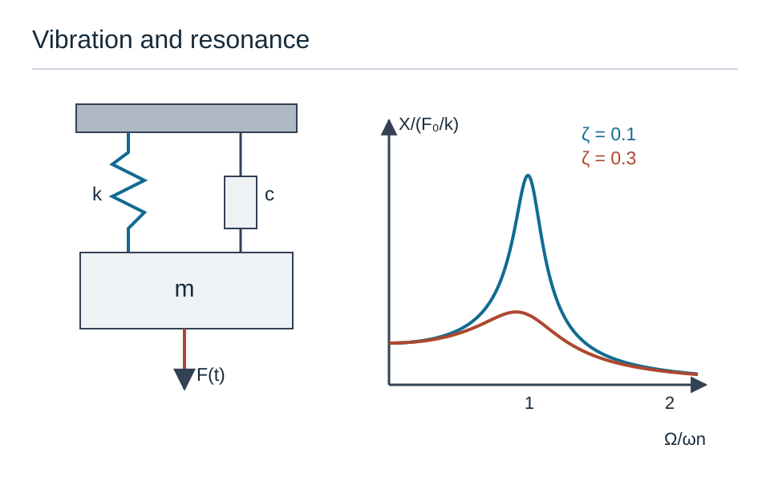

# M3-L5 – Vibration and resonance {#L5}

**Course area:** M3 – Kinematics and dynamics

**Level:** Bachelor

**Prerequisites:** [M3-L4 – Rigid bodies and rotation](M3-L4.md)

**Learning objective:** Interpret natural frequency and resonance of a linear single-mass oscillator.

## Introduction {#S1}

A motor may excite a machine structure periodically. A small excitation force can produce a large response near a natural frequency.

## Foundations, concepts and model {#S2}

For displacement from static equilibrium, $m\ddot x+c\dot x+kx=F_0\cos(\Omega t)$. Mass m, damping c and stiffness k determine the dynamics. Without damping and excitation, $\omega_n=\sqrt{k/m}$ and $f_n=\omega_n/(2\pi)$. The dimensionless damping ratio is $\zeta=c/(2\sqrt{km})$.

The steady-state amplitude is $X=F_0/\sqrt{(k-m\Omega^2)^2+(c\Omega)^2}$. At low damping, the maximum is near the natural frequency; the exact displacement resonance frequency for $0<\zeta<1/\sqrt 2$ is below $\omega_n$. Damping limits amplitude and changes phase.

*Single-mass oscillator with spring and damper and frequency response.*

## Worked example {#S3}

Mass 5 kg, stiffness 2000 N/m, damping 20 N·s/m. Natural angular frequency 20 rad/s, frequency 3.18 Hz, damping ratio 0.1. At 20 rad/s excitation and 10 N force amplitude: X = 10/(20·20) = 0.025 m.

## Self-assessment {#S4}

### Exercises

1. How does natural frequency change at four times the mass?
2. What static displacement is produced by 10 N at 2000 N/m?

::: {.lc-solutions data-lc-section="S4"}
### Solutions

1. It halves.
2. 5 mm.
:::

## Assumptions and limitations {#S5}

Linear spring and viscous damper; real systems may have multiple modes and nonlinear contacts.

## Summary and transition {#S6}

Vibration analysis connects force balance, differential equations and design measures to avoid resonance.

**Continue:** [M4-L1 – Crystal structure and microstructure](M4-L1.md)

## Sources {#S7}

- [OpenStax – Oscillations: Key Equations](https://openstax.org/books/university-physics-volume-1/pages/15-key-equations) · Ch. 15 harmonic and damped motion · Last accessed: 2026-11-25

